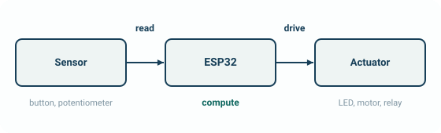
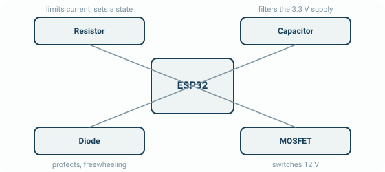

A **microcontroller** is a complete computer on a single chip: a processor, memory and **input and output pins** that your program drives. The ESP32 is a very widespread one that adds Wi-Fi and Bluetooth.

Inside, the chip holds millions of tiny MOSFET transistors working as switches: each one is off or on, which encodes a 0 or a 1. They are the switching transistors you already know, in microscopic form.

## Read, compute, drive

Every microcontroller program follows the same loop:

1. **read** an input: a button, a potentiometer, a temperature sensor;
2. **compute**: compare with a threshold, count, wait;
3. **drive** an output: light an LED, run a motor, send a message.

## Your components do not disappear

The microcontroller does not replace discrete components: it needs them to talk to the outside world, which is more powerful, slower or noisier than it is.

| Component | Role around the ESP32 |
|---|---|
| Resistor | limits the current of an LED, sets the state of an input (pull), lowers a voltage through a divider |
| Capacitor | filters the 3.3 V supply when the chip suddenly draws current (Wi-Fi transmission) |
| Diode | protects against reverse polarity, absorbs the surge of a relay or a motor (freewheeling) |
| MOSFET | switches a 12 V load that the pin could never supply on its own |

Ohm's law remains your first tool: it sizes the resistor of an LED (module M2) or the divider that brings 5 V down to 3.3 V (section 5 of this module).

## Key points

- A microcontroller reads inputs, computes and drives outputs, in a loop.
- Resistors, capacitors, diodes and MOSFETs **interface**, **power** and **protect** it.
