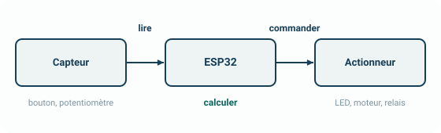
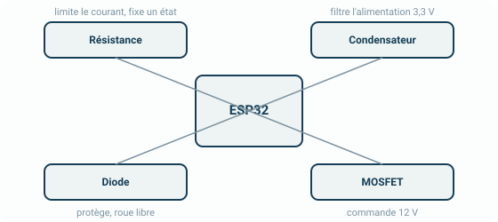

Un **microcontrôleur** est un ordinateur complet tenu dans une seule puce : un processeur, de la mémoire et des **broches d'entrée et de sortie** que votre programme commande. L'ESP32 en est un, très répandu, qui ajoute le Wi-Fi et le Bluetooth.

À l'intérieur, la puce contient des millions de transistors MOSFET minuscules qui travaillent en interrupteurs : chacun est bloqué ou passant, ce qui code un 0 ou un 1. Ce sont les transistors en commutation que vous connaissez, en version microscopique.

## Lire, calculer, commander

Tout programme de microcontrôleur suit la même boucle :

1. **lire** une entrée : un bouton, un potentiomètre, un capteur de température ;
2. **calculer** : comparer à un seuil, compter, attendre ;
3. **commander** une sortie : allumer une LED, faire tourner un moteur, envoyer un message.

## Vos composants ne disparaissent pas

Le microcontrôleur ne remplace pas les composants discrets : il en a besoin pour dialoguer avec le monde extérieur, qui est plus puissant, plus lent ou plus bruyant que lui.

| Composant | Rôle autour de l'ESP32 |
|---|---|
| Résistance | limite le courant d'une LED, fixe l'état d'une entrée (tirage), abaisse une tension par un pont diviseur |
| Condensateur | filtre l'alimentation 3,3 V quand la puce consomme d'un coup (émission Wi-Fi) |
| Diode | protège contre une inversion de polarité, absorbe la surtension d'un relais ou d'un moteur (roue libre) |
| MOSFET | commande une charge de 12 V que la broche ne pourrait jamais alimenter seule |

La loi d'Ohm reste votre premier outil : c'est elle qui dimensionne la résistance d'une LED (module M2) ou le pont qui ramène 5 V à 3,3 V (section 5 de ce module).

## À retenir

- Un microcontrôleur lit des entrées, calcule et commande des sorties, en boucle.
- Résistances, condensateurs, diodes et MOSFET servent à l'**interfacer**, l'**alimenter** et le **protéger**.
