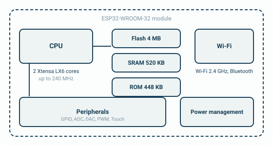

The board you use carries an **ESP32-WROOM-32 module**: a small plate holding the ESP32 chip, its Flash memory, a crystal and a printed antenna. The metal cover shields it from radio interference.

## The processor

The ESP32 has **two** Xtensa LX6 **cores** running at up to **240 MHz**. With the Arduino environment, your program runs on one core; the other mostly handles Wi-Fi and Bluetooth. A small ultra-low-power coprocessor (ULP) can keep watch while the cores sleep.

## Three memories, three roles

- **Flash (4 MB)**: it keeps your program even without power, like a USB stick. Uploading writes into it.
- **SRAM (520 KB)**: it holds the variables while the program runs. It is erased at every power-off.
- **ROM (448 KB)**: it contains the boot program, written at the factory. It cannot be changed.

## The peripherals

Around the processor, **peripherals** do part of the work in its place:

| Peripheral | What it does | Module |
|---|---|---|
| GPIO | digital inputs and outputs (0 or 3.3 V) | M2, M3 |
| ADC | measures a voltage (18 channels, 12 bits) | M6 |
| LEDC (PWM) | sets a brightness or a speed (16 channels) | M6 |
| Touch | detects a finger (10 capacitive pins) | M6 |
| DAC | produces a voltage (2 channels, 8 bits) | M6 |
| UART, I2C, SPI | talk to a computer, a display, a sensor | M5, M7 |
| Wi-Fi, Bluetooth | communicate wirelessly | M9 |

Finally, **power management** puts the chip into deep sleep, where it draws only about ten microamps (module M8).

## Key points

- Two cores at 240 MHz, 4 MB of Flash for the program, 520 KB of SRAM for the variables.
- The peripherals (GPIO, ADC, PWM, Touch, UART, I2C, SPI, Wi-Fi) are studied one by one in the course.
