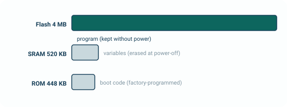
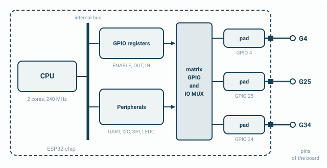

The board you use carries an **ESP32-WROOM-32 module**: a small plate holding the ESP32 chip, its Flash memory, a crystal and a printed antenna. The metal cover shields it from radio interference.

## The processor

The ESP32 has **two** Xtensa LX6 **cores** running at up to **240 MHz**. With the Arduino environment, your program runs on one core; the other mostly handles Wi-Fi and Bluetooth. A small ultra-low-power coprocessor (ULP) can keep watch while the cores sleep.

## Three memories, three roles

- **Flash (4 MB)**: it keeps your program even without power, like a USB stick. Uploading writes into it.
- **SRAM (520 KB)**: it holds the variables while the program runs. It is erased at every power-off.
- **ROM (448 KB)**: it contains the boot program, written at the factory. It cannot be changed.

## The peripherals

Around the processor, **peripherals** do part of the work in its place:

| Peripheral | What it does | Module |
|---|---|---|
| GPIO | digital inputs and outputs (0 or 3.3 V) | M2, M3 |
| ADC | measures a voltage (18 channels, 12 bits) | M6 |
| LEDC (PWM) | sets a brightness or a speed (16 channels) | M6 |
| Touch | detects a finger (10 capacitive pins) | M6 |
| DAC | produces a voltage (2 channels, 8 bits) | M6 |
| UART, I2C, SPI | talk to a computer, a display, a sensor | M5, M7 |
| Wi-Fi, Bluetooth | communicate wirelessly | M9 |

Finally, **power management** puts the chip into deep sleep, where it draws only about ten microamps (module M8).

## From the program to the pin of the board

How does a line of the program end up lighting an LED wired to the board? The block diagram below follows a signal from inside the chip to the pin you wire.

1. **The CPU** runs the program. To act on the outside world, it writes to special memory slots, the **registers**, over the **internal bus**.
2. **The GPIO registers** drive the pins directly as digital inputs and outputs: one bit per pin says whether it is an output, another gives its level (module M2, section 5). **The peripherals** (UART, I2C, SPI, LEDC…) produce their own signals once the CPU has set them up.
3. **The GPIO matrix and the IO MUX** are a switchboard: they connect each signal, from a register or a peripheral, to the pin chosen by the program. That is why a PWM output or a serial link can go on almost any safe pin. The analog functions (ADC, DAC, Touch) bypass the switchboard: they are wired to fixed pins, hence the imposed numbers of module M6.
4. **The input-output pad** is the electronics at the edge of the chip: two switches for the output, a comparator for the input, two pull resistors that the program connects (modules M2 and M3).
5. **The module pin**, then **the board pin**: the chip is soldered into the module, the module onto the board, and a track connects the pad to the pin marked **G25** on the silkscreen.

So `digitalWrite(25, HIGH)` sets bit 25 of a register to 1; the switchboard connects that bit to pad 25; the pad closes its switch towards 3.3 V; pin G25 of the board goes to 3.3 V.

## Key points

- Two cores at 240 MHz, 4 MB of Flash for the program, 520 KB of SRAM for the variables.
- The peripherals (GPIO, ADC, PWM, Touch, UART, I2C, SPI, Wi-Fi) are studied one by one in the course.
- A signal follows the path CPU, register or peripheral, GPIO matrix, pad, module pin, board pin (G25 for GPIO 25).
