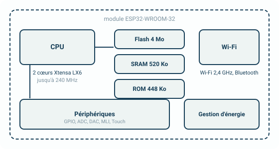
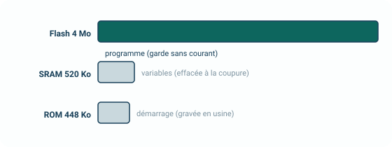
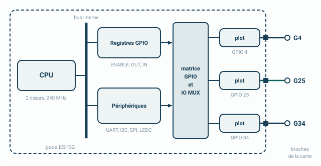

La carte que vous utilisez porte un **module ESP32-WROOM-32** : une petite plaque qui contient la puce ESP32, sa mémoire Flash, un quartz et une antenne imprimée. Le capot métallique protège des perturbations radio.

## Le processeur

L'ESP32 possède **deux cœurs** Xtensa LX6 qui tournent jusqu'à **240 MHz**. Avec l'environnement Arduino, votre programme s'exécute sur un cœur ; l'autre gère surtout le Wi-Fi et le Bluetooth. Un petit coprocesseur à très basse consommation (ULP) peut veiller pendant que les cœurs dorment.

## Trois mémoires, trois rôles

- **Flash (4 Mo)** : elle garde votre programme même sans courant, comme une clé USB. Le téléversement écrit dedans.
- **SRAM (520 Ko)** : elle contient les variables pendant l'exécution. Elle s'efface à chaque coupure.
- **ROM (448 Ko)** : elle contient le programme de démarrage, gravé en usine. On ne peut pas la modifier.

## Les périphériques

Autour du processeur, des **périphériques** font une partie du travail à sa place :

| Périphérique | Ce qu'il fait | Module |
|---|---|---|
| GPIO | entrées et sorties numériques (0 ou 3,3 V) | M2, M3 |
| ADC | mesure une tension (18 voies, 12 bits) | M6 |
| LEDC (MLI) | règle une luminosité ou une vitesse (16 voies) | M6 |
| Touch | détecte un doigt (10 broches capacitives) | M6 |
| DAC | produit une tension (2 voies, 8 bits) | M6 |
| UART, I2C, SPI | dialoguent avec un ordinateur, un écran, un capteur | M5, M7 |
| Wi-Fi, Bluetooth | communiquent sans fil | M9 |

La **gestion d'énergie** permet enfin de mettre la puce en veille profonde, où elle ne consomme qu'une dizaine de microampères (module M8).

## Du programme à la broche de la carte

Comment une ligne du programme finit-elle par allumer une LED branchée sur la carte ? Le schéma bloc ci-dessous suit le chemin d'un signal, de l'intérieur de la puce jusqu'à la broche que vous câblez.

1. **Le CPU** exécute le programme. Pour agir sur le monde extérieur, il écrit dans des cases mémoire spéciales, les **registres**, par le **bus interne**.
2. **Les registres GPIO** commandent directement les broches en entrée-sortie numérique : un bit par broche dit si elle est une sortie, un autre son niveau (module M2, section 5). **Les périphériques** (UART, I2C, SPI, LEDC…) produisent eux-mêmes leurs signaux, une fois réglés par le CPU.
3. **La matrice GPIO et l'IO MUX** sont un aiguillage : ils relient chaque signal, d'un registre ou d'un périphérique, à la broche choisie par le programme. C'est pourquoi on peut placer une sortie MLI ou une liaison série sur presque n'importe quelle broche sûre. Les fonctions analogiques (ADC, DAC, Touch) échappent à l'aiguillage : elles sont câblées à des broches fixes, d'où les numéros imposés du module M6.
4. **Le plot d'entrée-sortie** (*pad*) est l'électronique au bord de la puce : deux interrupteurs pour la sortie, un comparateur pour l'entrée, deux résistances de tirage qu'on branche par programme (modules M2 et M3).
5. **La broche du module**, puis **la broche de la carte** : la puce est soudée dans le module, le module sur la carte, et une piste relie le plot à la broche marquée **G25** sur la sérigraphie.

Ainsi, `digitalWrite(25, HIGH)` met à 1 le bit 25 d'un registre ; l'aiguillage relie ce bit au plot 25 ; le plot ferme son interrupteur vers 3,3 V ; la broche G25 de la carte passe à 3,3 V.

La figure suit ce chemin étape par étape, une LED branchée sur G25. Avancez avec « Étape suivante » : l'étape en cours passe en teal et chaque pièce garde son ancien état tant que le signal ne l'a pas atteinte. Écrivez ensuite `LOW` et refaites le chemin : seul le registre visé change (W1TC au lieu de W1TS), puis l'interrupteur fermé (N au lieu de P).

[[fig:pin_path]]

## À retenir

- Deux cœurs à 240 MHz, une Flash de 4 Mo pour le programme, 520 Ko de SRAM pour les variables.
- Les périphériques (GPIO, ADC, MLI, Touch, UART, I2C, SPI, Wi-Fi) sont étudiés un à un dans la formation.
- Un signal suit le chemin CPU, registre ou périphérique, matrice GPIO, plot, broche du module, broche de la carte (G25 pour GPIO 25).
