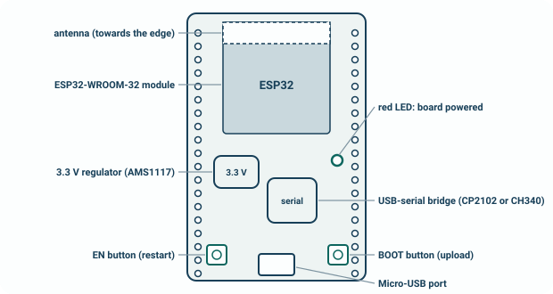
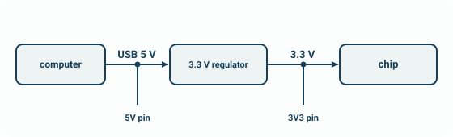

You do not program the module on its own: it is soldered onto a **development board**, here a **38-pin DevKit**. The board adds everything needed to plug it into a computer and wire it on a breadboard.

## What the board adds to the module

- **The USB port** (micro-USB or USB-C): it powers the board and carries the program and the messages.
- **The USB-serial bridge** (CP2102 or CH340 chip): it turns the computer's USB into a serial link the ESP32 understands. You sometimes need to install its driver on the computer.
- **The 3.3 V regulator**: it lowers the 5 V from USB to 3.3 V, the chip voltage.
- **The EN button**: it restarts the chip, like a reset button.
- **The BOOT button**: held during a restart, it puts the chip into upload mode. Most of the time the computer does this on its own through the USB-serial bridge.

## The power supply

Two pins of the board give access to the supply:

- **5V**: wired to the USB 5 V. Useful to power a 5 V sensor, never to drive an input of the chip.
- **3V3**: the regulator output. It powers your small 3.3 V sensors, as long as you stay modest (a few tens of milliamps).

Several **GND** pins give the ground, the 0 V reference of every signal.

> **30-pin variant.** Some DevKit boards have only 30 pins: they mostly leave out the Flash pins (GPIO 6 to 11). The GPIO numbers do not change; find them on your board's silkscreen before wiring. The ESP32-S3 and ESP32-C3 are different chips: their pinout differs, always check it.

## Key points

- The DevKit board adds USB, the USB-serial bridge, the 3.3 V regulator and the EN and BOOT buttons.
- The 5V pin comes from USB; the chip itself works at 3.3 V.
