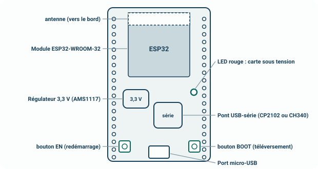

On ne programme pas le module seul : il est soudé sur une **carte de développement**. La formation utilise l'**ESP32-DevKitC V4**, la carte de référence d'Espressif, ou l'un de ses nombreux **clones à 38 broches** : même brochage, même disposition, parfois une autre puce USB-série. Elle ajoute tout ce qu'il faut pour la brancher à un ordinateur et la câbler sur une plaque d'essai.

## Ce que la carte ajoute au module

Posez la carte devant vous, port USB vers vous. De haut en bas :

- **Le module ESP32-WROOM-32**, sous son capot métallique. La bande sans capot, tout en haut, est l'**antenne** imprimée : ne posez ni métal ni fil dessus, le Wi-Fi en souffrirait.
- **Le régulateur 3,3 V** (souvent un AMS1117, trois pattes et une languette) : il abaisse le 5 V de l'USB à 3,3 V, la tension de la puce.
- **Le pont USB-série** (puce CP2102 sur la carte d'origine, CP2102 ou CH340 sur les clones) : il traduit l'USB de l'ordinateur en liaison série que l'ESP32 comprend. Il faut parfois installer son pilote sur l'ordinateur.
- **La LED rouge** : elle s'allume dès que la carte est alimentée. C'est un témoin d'alimentation ; **aucune LED de la carte n'est reliée à une broche GPIO**. Pour voir un programme agir, on câble une LED externe (section 7).
- **Le port micro-USB** : il alimente la carte et transporte le programme et les messages. Utilisez un câble qui transporte des données, pas un simple câble de charge.
- **Le bouton EN**, à gauche du port : il redémarre la puce, comme un bouton reset.
- **Le bouton BOOT**, à droite du port : maintenu pendant un redémarrage, il met la puce en mode téléversement. Le plus souvent, l'ordinateur le fait tout seul par le pont USB-série.

## L'alimentation

Deux broches de la carte donnent accès à l'alimentation :

- **5V** (en bas à gauche) : reliée au 5 V de l'USB. Utile pour alimenter un capteur en 5 V, jamais pour attaquer une entrée de la puce.
- **3V3** (en haut à gauche) : la sortie du régulateur. Elle alimente vos petits capteurs en 3,3 V, à condition de rester modeste (quelques dizaines de milliampères).

Trois broches **GND** donnent la masse, la référence 0 V de tous les signaux : une à gauche entre G12 et G13, deux à droite (tout en haut et entre G21 et G19).

## Sur la plaque d'essai

La carte est large : posée au milieu d'une plaque d'essai ordinaire, elle ne laisse souvent qu'une rangée de trous libre d'un côté. Deux solutions : deux plaques d'essai accolées, la carte à cheval sur leur jonction, ou des fils mâle-femelle branchés directement sur ses broches.

> **Variante 30 broches.** Certaines cartes DevKit n'ont que 30 broches : elles omettent surtout les broches de la Flash (GPIO 6 à 11). Les numéros GPIO ne changent pas ; repérez-les sur la sérigraphie de votre carte avant de câbler. Les ESP32-S3 et ESP32-C3 sont d'autres puces : leur brochage est différent, vérifiez-le toujours.

## À retenir

- La DevKitC V4 ajoute au module l'USB, le pont USB-série, le régulateur 3,3 V, la LED d'alimentation et les boutons EN et BOOT.
- Sa seule LED est un témoin d'alimentation : une LED commandée par programme se câble à l'extérieur.
- La broche 5V vient de l'USB ; la puce, elle, travaille en 3,3 V.
