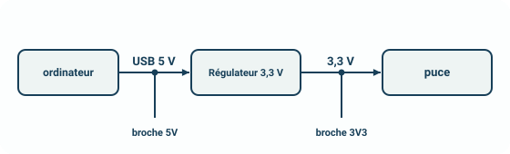

On ne programme pas le module seul : il est soudé sur une **carte de développement**, ici une **DevKit 38 broches**. Elle ajoute tout ce qu'il faut pour la brancher à un ordinateur et la câbler sur une plaque d'essai.

## Ce que la carte ajoute au module

- **Le port USB** (micro-USB ou USB-C) : il alimente la carte et transporte le programme et les messages.
- **Le pont USB-série** (puce CP2102 ou CH340) : il traduit l'USB de l'ordinateur en liaison série que l'ESP32 comprend. Il faut parfois installer son pilote sur l'ordinateur.
- **Le régulateur 3,3 V** : il abaisse le 5 V de l'USB à 3,3 V, la tension de la puce.
- **Le bouton EN** : il redémarre la puce, comme un bouton reset.
- **Le bouton BOOT** : maintenu pendant un redémarrage, il met la puce en mode téléversement. Le plus souvent, l'ordinateur le fait tout seul par le pont USB-série.

## L'alimentation

Deux broches de la carte donnent accès à l'alimentation :

- **5V** : reliée au 5 V de l'USB. Utile pour alimenter un capteur en 5 V, jamais pour attaquer une entrée de la puce.
- **3V3** : la sortie du régulateur. Elle alimente vos petits capteurs en 3,3 V, à condition de rester modeste (quelques dizaines de milliampères).

Plusieurs broches **GND** donnent la masse, la référence 0 V de tous les signaux.

> **Variante 30 broches.** Certaines cartes DevKit n'ont que 30 broches : elles omettent surtout les broches de la Flash (GPIO 6 à 11). Les numéros GPIO ne changent pas ; repérez-les sur la sérigraphie de votre carte avant de câbler. Les ESP32-S3 et ESP32-C3 sont d'autres puces : leur brochage est différent, vérifiez-le toujours.

## À retenir

- La carte DevKit ajoute l'USB, le pont USB-série, le régulateur 3,3 V et les boutons EN et BOOT.
- La broche 5V vient de l'USB ; la puce, elle, travaille en 3,3 V.
