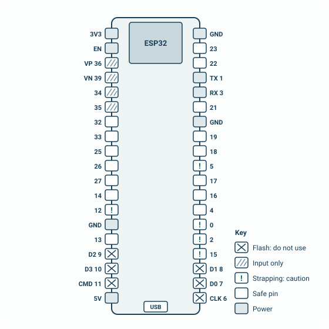
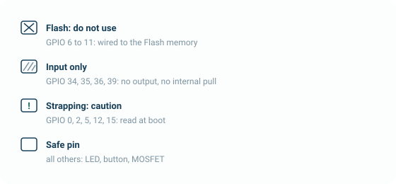

The board exposes 38 pins, but they are not all alike. Knowing their **categories** avoids most beginner failures: a board that no longer boots, a program that crashes as soon as a button is wired.

## Four categories

**Flash pins: GPIO 6 to 11.** They connect the chip to its Flash memory, the one holding the program. Touching them cuts the chip off from its program: it crashes. They are **never** used. On the board they are often marked CLK, D0 to D3 and CMD.

**Input-only pins: GPIO 34, 35, 36 and 39.** They can read, not write: you cannot light an LED with them. They have no internal pull resistor either (module M3). They suit a potentiometer or an analog sensor very well. On the board, 36 and 39 are marked VP and VN.

**Strapping pins: GPIO 0, 2, 5, 12 and 15.** The chip reads their state **at boot** to choose its mode. A component that forces them to a level at the wrong moment prevents booting or uploading. Example: GPIO 12 high at boot makes the chip believe its Flash runs at 1.8 V, and it does not start. They can be used with care once the chip has booted. GPIO 2 often carries the board's built-in LED: that is harmless.

**Safe pins: all the others.** GPIO 4, 13, 14, 16 to 19, 21 to 23, 25 to 27, 32 and 33 suit an LED, a button or a MOSFET.

## Reserved pins

- **GPIO 1 (TX) and GPIO 3 (RX)** carry the serial link with the computer: leave them to uploading and the serial monitor.
- **GPIO 21 (SDA) and GPIO 22 (SCL)** are the usual pins of the I2C bus (module M7).

## Key points

- Never GPIO 6 to 11.
- GPIO 34 to 39: input only, no internal pull.
- GPIO 0, 2, 5, 12, 15: care at boot.
- To start with: 4, 13, 16 to 19, 21 to 23, 25 to 27, 32, 33.
