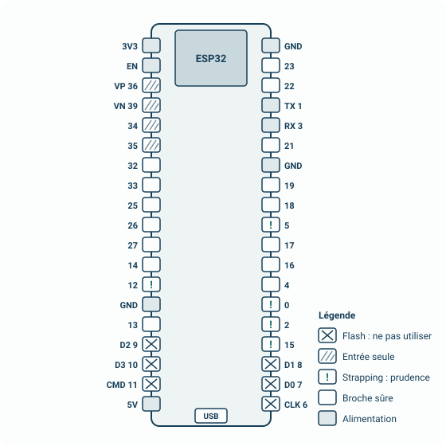

La carte expose 38 broches, mais elles ne se valent pas. Connaître leurs **catégories** évite la plupart des pannes de débutant : une carte qui ne démarre plus, un programme qui plante dès qu'on branche un bouton.

## Quatre catégories

**Broches de la Flash : GPIO 6 à 11.** Elles relient la puce à sa mémoire Flash, celle qui contient le programme. Les toucher, c'est couper la puce de son programme : elle plante. On ne les utilise **jamais**. Sur la carte, elles sont souvent marquées CLK, D0 à D3 et CMD.

**Entrées seules : GPIO 34, 35, 36 et 39.** Elles savent lire, pas écrire : impossible d'allumer une LED avec. Elles n'ont pas non plus de résistance de tirage interne (module M3). Elles conviennent très bien à un potentiomètre ou à un capteur analogique. Sur la carte, 36 et 39 sont marquées VP et VN.

**Broches de strapping : GPIO 0, 2, 5, 12 et 15.** La puce lit leur état **au démarrage** pour choisir son mode. Un composant qui les force à un niveau au mauvais moment empêche le démarrage ou le téléversement. Exemple : GPIO 12 au niveau haut au démarrage fait croire à la puce que sa Flash est alimentée en 1,8 V, et elle ne démarre pas. On peut les utiliser avec prudence, une fois le démarrage fait. GPIO 2 porte souvent la LED intégrée de la carte : c'est sans danger.

**Broches sûres : les autres.** GPIO 4, 13, 14, 16 à 19, 21 à 23, 25 à 27, 32 et 33 conviennent à une LED, un bouton ou un MOSFET.

## Les broches réservées

- **GPIO 1 (TX) et GPIO 3 (RX)** portent la liaison série avec l'ordinateur : on les laisse au téléversement et au moniteur série.
- **GPIO 21 (SDA) et GPIO 22 (SCL)** sont les broches habituelles du bus I2C (module M7).

## À retenir

- Jamais GPIO 6 à 11.
- GPIO 34 à 39 : entrées seules, sans tirage interne.
- GPIO 0, 2, 5, 12, 15 : prudence au démarrage.
- Pour débuter : 4, 13, 16 à 19, 21 à 23, 25 à 27, 32, 33.
