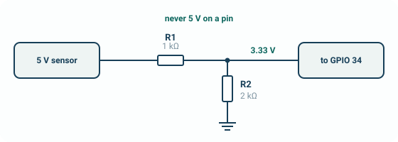
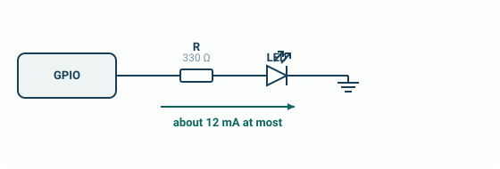
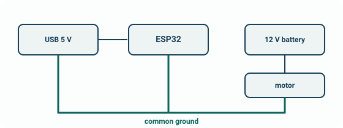

Three rules protect the board. They apply to every circuit in the course; the mini-projects repeat them in their safety instructions.

## Rule 1: logic runs at 3.3 V

A digital pin knows only two states: **0 V** (low level, 0) and **3.3 V** (high level, 1). Unlike a 5 V Arduino Uno board, the ESP32 accepts no more than 3.3 V on a pin: **5 V destroys it**.

To read a sensor that outputs 5 V, lower the signal with a **voltage divider**:

Vout = Vin × R2 / (R1 + R2) = 5 V × 2000 / 3000 ≈ 3.33 V.

[[calc:divider]]

## Rule 2: a few milliamps per pin

A pin is not a power supply. The datasheet gives up to 40 mA at the strongest setting, but aim for **about 12 mA at most** per pin to spare the chip. An LED with its resistor, yes; a motor, a relay or an LED strip, never directly: go through a **MOSFET** (module M2).

## Rule 3: common ground

When two supplies work together (USB for the ESP32, a 12 V battery for a motor), **join their GNDs**. Without a common ground, the 3.3 V of the pin has no reference for the motor circuit, and the MOSFET does not switch.

## Key points

- Never more than 3.3 V on a pin; a voltage divider lowers a 5 V signal.
- About a dozen milliamps per pin at most; a MOSFET beyond.
- Two supplies: GNDs joined.
- Throughout the course, no circuit goes above 12 V DC.
