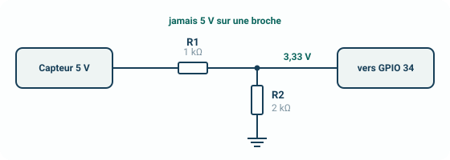
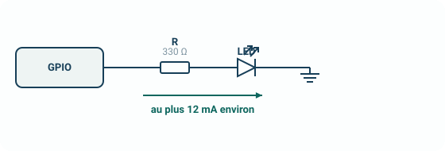
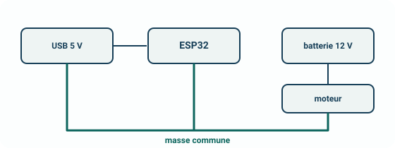

Trois règles protègent la carte. Elles valent pour chaque montage de la formation ; les mini-projets les rappellent dans leur consigne de sécurité.

## Règle 1 : la logique est en 3,3 V

Une broche numérique ne connaît que deux états : **0 V** (niveau bas, 0) et **3,3 V** (niveau haut, 1). Contrairement à une carte Arduino Uno en 5 V, l'ESP32 n'accepte pas plus de 3,3 V sur une broche : **5 V la détruit**.

Pour lire un capteur qui sort 5 V, on abaisse le signal avec un **pont diviseur** :

Vs = Ve × R2 / (R1 + R2) = 5 V × 2 000 / 3 000 ≈ 3,33 V.

[[calc:divider]]

## Règle 2 : quelques milliampères par broche

Une broche n'est pas une alimentation. La fiche technique annonce jusqu'à 40 mA au réglage le plus fort, mais on vise **au plus 12 mA environ** par broche pour ménager la puce. Une LED avec sa résistance, oui ; un moteur, un relais ou un ruban de LED, jamais en direct : on passe par un **MOSFET** (module M2).

## Règle 3 : la masse commune

Quand deux alimentations travaillent ensemble (l'USB pour l'ESP32, une batterie de 12 V pour un moteur), on **relie leurs GND**. Sans masse commune, le 3,3 V de la broche n'a pas de référence pour le circuit du moteur, et le MOSFET ne commute pas.

## À retenir

- Jamais plus de 3,3 V sur une broche ; un pont diviseur abaisse un signal de 5 V.
- Au plus une douzaine de milliampères par broche ; un MOSFET au-delà.
- Deux alimentations : GND reliés.
- Dans toute la formation, aucun montage ne dépasse 12 V en continu.
