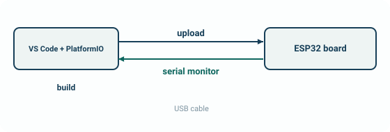
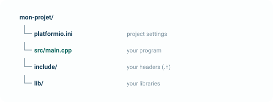

To program the ESP32, you write C++ on the computer, **build** it into machine code, then **upload** it into the board's Flash. In this course the main tool is **PlatformIO**, an extension of the **VS Code** editor.



## Install

1. Install **VS Code** (free, Windows, macOS or Linux).
2. In the extensions tab, search for **PlatformIO IDE** and install it. The first time, it downloads its tools: allow a few minutes.
3. Plug the board in over USB. If the computer does not see it, install the driver of your board's USB-serial bridge (CP2102 or CH340) and check that the cable carries data, not only charge.

## Create a project

On the PlatformIO home page, choose **New Project**, give a name, choose the **Espressif ESP32 Dev Module** board and the **Arduino** framework. PlatformIO creates an organised folder:



Replace the content of `platformio.ini` with the course reference file. It pins the version of the platform and of the libraries: every program of the course builds with it.

```ini
[env:esp32dev]
platform = espressif32 @ 8.0.0
board = esp32dev
framework = arduino
monitor_speed = 115200
lib_deps =
    adafruit/Adafruit SSD1306 @ 2.5.17
    adafruit/Adafruit GFX Library @ 1.13.0
    adafruit/Adafruit BME280 Library @ 2.3.0
```

- `platform`: the official espressif32 8.0.0 platform, which ships the Arduino-ESP32 3.3.12 core;
- `board = esp32dev`: the DevKit board with an ESP32-WROOM-32;
- `monitor_speed = 115200`: the serial monitor speed, the same as in the program (module M5);
- `lib_deps`: the libraries of the display and sensor of module M7, downloaded automatically.

## The three buttons to know

In the bottom bar of VS Code: the **tick** builds, the **arrow** uploads, the **plug** opens the serial monitor.

> **Box: the Arduino IDE 2.** You can also use the Arduino IDE. In File, Preferences, add the board manager URL `https://espressif.github.io/arduino-esp32/package_esp32_index.json`, install the **esp32 by Espressif Systems** package at version 3.3.12 and choose the **ESP32 Dev Module** board. The course programs build there too; in an Arduino sketch, the `#include <Arduino.h>` line is optional.

## Key points

- VS Code and PlatformIO build, upload and open the serial monitor.
- A project = `platformio.ini` (settings) and `src/main.cpp` (program).
- The reference file pins the versions: keep it for every program.
