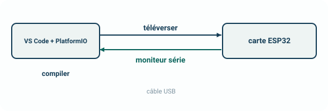
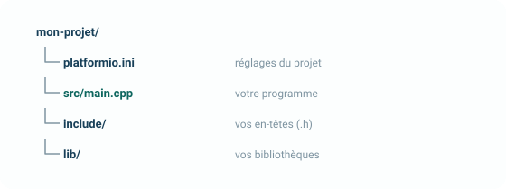

Pour programmer l'ESP32, on écrit du C++ sur l'ordinateur, on le **compile** en code machine, puis on le **téléverse** dans la Flash de la carte. Dans cette formation, l'outil principal est **PlatformIO**, une extension de l'éditeur **VS Code**.



## Installer

1. Installez **VS Code** (gratuit, Windows, macOS ou Linux).
2. Dans l'onglet des extensions, cherchez **PlatformIO IDE** et installez-la. Elle télécharge la première fois ses outils : comptez quelques minutes.
3. Branchez la carte par USB. Si l'ordinateur ne la voit pas, installez le pilote du pont USB-série de votre carte (CP2102 ou CH340) et vérifiez que le câble transporte des données, pas seulement la charge.

## Créer un projet

Dans l'accueil de PlatformIO, choisissez **New Project**, donnez un nom, choisissez la carte **Espressif ESP32 Dev Module** et le framework **Arduino**. PlatformIO crée un dossier organisé :



Remplacez le contenu de `platformio.ini` par le fichier de référence de la formation. Il fige la version de la plateforme et des bibliothèques : tous les programmes du cours compilent avec lui.

```ini
[env:esp32dev]
platform = espressif32 @ 8.0.0
board = esp32dev
framework = arduino
monitor_speed = 115200
lib_deps =
    adafruit/Adafruit SSD1306 @ 2.5.17
    adafruit/Adafruit GFX Library @ 1.13.0
    adafruit/Adafruit BME280 Library @ 2.3.0
```

- `platform` : la plateforme officielle espressif32 8.0.0, qui embarque le cœur Arduino-ESP32 3.3.12 ;
- `board = esp32dev` : une carte à ESP32-WROOM-32, comme la DevKitC V4 ;
- `monitor_speed = 115200` : la vitesse du moniteur série, la même que dans le programme (module M5) ;
- `lib_deps` : les bibliothèques de l'écran et du capteur du module M7, téléchargées toutes seules.

## Les trois boutons à connaître

Dans la barre du bas de VS Code : la **coche** compile, la **flèche** téléverse, la **prise** ouvre le moniteur série.

> **Encadré : l'IDE Arduino 2.** Vous pouvez aussi utiliser l'IDE Arduino. Dans Fichier, Préférences, ajoutez l'URL de gestionnaire de cartes `https://espressif.github.io/arduino-esp32/package_esp32_index.json`, installez le paquet **esp32 by Espressif Systems** en version 3.3.12 et choisissez la carte **ESP32 Dev Module**. Les programmes du cours y compilent aussi ; dans un croquis Arduino, la ligne `#include <Arduino.h>` est facultative.

## À retenir

- VS Code et PlatformIO compilent, téléversent et ouvrent le moniteur série.
- Un projet = `platformio.ini` (réglages) et `src/main.cpp` (programme).
- Le fichier de référence fige les versions : gardez-le pour tous les programmes.
