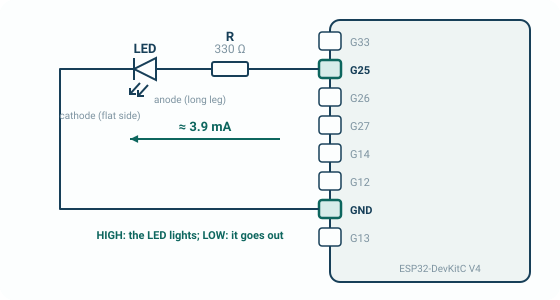
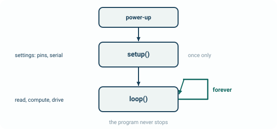
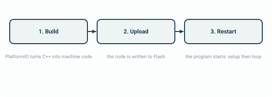

Here is the first complete program: it blinks an LED and the board greets you in the serial monitor. The ESP32-DevKitC V4 board has **no LED the program can drive**: its only LED, a red one, shows that it is powered. So you first wire an external LED on GPIO 25.

## Wiring the LED



The circuit starts at pin **G25** (GPIO 25), goes through a **330 Ω resistor**, then the **LED**, and returns to a **GND** pin of the board. It is a closed loop: when the program sets G25 to 3.3 V, a current of about 4 mA flows through it and the LED lights; at 0 V, no more current, the LED goes out.

| Part | Connection | Why |
|---|---|---|
| pin G25 | start of the circuit | safe pin, left side of the board (module M1, section 4) |
| 330 Ω resistor | between G25 and the anode | limits the current to about 4 mA; without it, the LED and the pin would be damaged |
| red LED, anode | resistor side | the anode is the **long leg** |
| red LED, cathode | to GND | the cathode is the **short leg**, on the **flat side** of the package |
| GND pin | end of the circuit | the 0 V reference, between G12 and G13 on the board |

Wire with the **board unplugged from USB**, then check the LED direction before plugging it back: fitted the wrong way round, it does not light, without damage. Working out the resistor and the other ways of wiring an output are covered in module M2.

## The program

Copy it into `src/main.cpp`, upload it, then open the serial monitor.

```cpp
#include <Arduino.h>

// External LED and its 330 ohm resistor, on GPIO 25
const uint8_t LED_PIN = 25;
// Duration of each LED state, in milliseconds
const uint32_t HALF_PERIOD_MS = 500;

void setup() {
  // Runs once, at power-up
  Serial.begin(115200);
  pinMode(LED_PIN, OUTPUT);
  Serial.println("Hello, ESP32!");
}

void loop() {
  // Repeats forever
  digitalWrite(LED_PIN, HIGH);
  delay(HALF_PERIOD_MS);
  digitalWrite(LED_PIN, LOW);
  delay(HALF_PERIOD_MS);
}
```

## setup and loop



- `setup()` runs **once** after each power-up or each press on EN: it sets up the pins and the serial link.
- `loop()` repeats **forever**: it is the heart of the program. On a microcontroller, the program never ends.

## Line by line

- `#include <Arduino.h>` gives access to the Arduino functions (`pinMode`, `digitalWrite`, `delay`, `Serial`).
- `const uint8_t LED_PIN = 25;` names the pin: GPIO 25, marked G25 on the board. `uint8_t` is an integer from 0 to 255, enough for a pin number; `const` forbids changing it by mistake. Moving to another pin takes a single line.
- `const uint32_t HALF_PERIOD_MS = 500;`: a 32-bit integer for a duration in milliseconds. The `_MS` suffix recalls the unit.
- `Serial.begin(115200);` opens the serial link at 115200 bit/s, the `monitor_speed` speed.
- `pinMode(LED_PIN, OUTPUT);` makes the pin an output.
- `digitalWrite(LED_PIN, HIGH);` sets it to 3.3 V: current flows through the resistor and the LED; `LOW` sets it back to 0 V and the current stops.
- `delay(HALF_PERIOD_MS);` waits 500 ms. The LED stays on for 500 ms and off for 500 ms: a period of 1 s, that is 1 Hz.

## What happens during upload



If the upload fails with a message like *Failed to connect*, hold the BOOT button down at the start of the write, then release it.

## Key points

- The DevKitC V4 has no programmable LED: G25, a 330 Ω resistor, the LED (long leg on the resistor side), then GND.
- `setup()` once, `loop()` forever.
- Name pins and durations with typed constants: `const uint8_t`, `const uint32_t`.
- The program is written into Flash: it starts again on its own at the next power-up.
