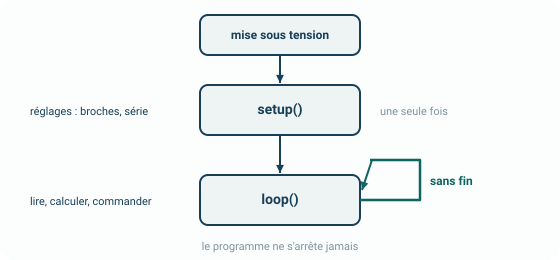
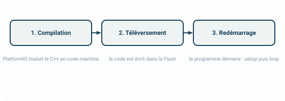

Voici le premier programme complet. Copiez-le dans `src/main.cpp`, téléversez-le, puis ouvrez le moniteur série : la LED intégrée clignote et la carte vous salue.

```cpp
#include <Arduino.h>

// LED intégrée de la carte (souvent reliée à GPIO 2)
const uint8_t LED_PIN = 2;
// Durée de chaque état de la LED, en millisecondes
const uint32_t HALF_PERIOD_MS = 500;

void setup() {
  // Exécuté une seule fois, à la mise sous tension
  Serial.begin(115200);
  pinMode(LED_PIN, OUTPUT);
  Serial.println("Bonjour, ESP32 !");
}

void loop() {
  // Répété sans fin
  digitalWrite(LED_PIN, HIGH);
  delay(HALF_PERIOD_MS);
  digitalWrite(LED_PIN, LOW);
  delay(HALF_PERIOD_MS);
}
```

## setup et loop



- `setup()` s'exécute **une seule fois** après chaque mise sous tension ou chaque appui sur EN : on y règle les broches et la liaison série.
- `loop()` se répète **sans fin** : c'est le cœur du programme. Sur un microcontrôleur, le programme ne se termine jamais.

## Ligne par ligne

- `#include <Arduino.h>` donne accès aux fonctions Arduino (`pinMode`, `digitalWrite`, `delay`, `Serial`).
- `const uint8_t LED_PIN = 2;` nomme la broche. `uint8_t` est un entier de 0 à 255, assez pour un numéro de broche ; `const` interdit de le modifier par erreur. Changer de broche ne demande qu'une ligne.
- `const uint32_t HALF_PERIOD_MS = 500;` : un entier de 32 bits pour une durée en millisecondes. Le suffixe `_MS` rappelle l'unité.
- `Serial.begin(115200);` ouvre la liaison série à 115 200 bit/s, la vitesse de `monitor_speed`.
- `pinMode(LED_PIN, OUTPUT);` fait de la broche une sortie.
- `digitalWrite(LED_PIN, HIGH);` la met à 3,3 V ; `LOW` la remet à 0 V.
- `delay(HALF_PERIOD_MS);` attend 500 ms. La LED reste 500 ms allumée puis 500 ms éteinte : une période de 1 s, soit 1 Hz.

## Ce qui se passe au téléversement



Si le téléversement échoue avec un message du type *Failed to connect*, maintenez le bouton BOOT enfoncé au début de l'écriture, puis relâchez-le.

## À retenir

- `setup()` une fois, `loop()` sans fin.
- Nommez broches et durées par des constantes typées : `const uint8_t`, `const uint32_t`.
- Le programme est écrit dans la Flash : il redémarre tout seul à la prochaine mise sous tension.
