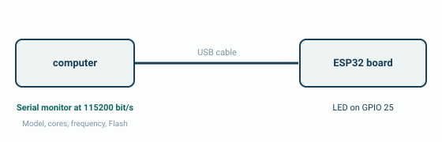

This mini-project checks the whole chain: installation, build, upload and serial monitor. The board shows its own identity card.

## Goal

Upload a program that reads the characteristics of the chip, shows them in the serial monitor and blinks the built-in LED.

## Safety

- The board is powered by the computer's USB at 5 V; the chip works at 3.3 V. No circuit in the course goes above **12 V** DC.
- Never connect 5 V to a GPIO pin.
- Put the board on an insulating surface: no metal part may touch its pins.



## Equipment

| Quantity | Item |
|---|---|
| 1 | DevKit ESP32-WROOM-32 board, 38 pins |
| 1 | USB cable that carries data |
| 1 | computer with VS Code and PlatformIO |
| 1 | multimeter |

## Program

```cpp
#include <Arduino.h>

// Built-in LED: it blinks to show that the program is running
const uint8_t LED_PIN = 2;
const uint32_t BLINK_MS = 1000;

void setup() {
  Serial.begin(115200);
  pinMode(LED_PIN, OUTPUT);
  // Leaves time to open the serial monitor
  delay(2000);
  Serial.println("Chip identity card:");
  Serial.printf("Model: %s, revision %d\n", ESP.getChipModel(), ESP.getChipRevision());
  Serial.printf("Cores: %d, frequency: %lu MHz\n", ESP.getChipCores(), (unsigned long)ESP.getCpuFreqMHz());
  Serial.printf("Flash: %lu bytes\n", (unsigned long)ESP.getFlashChipSize());
  Serial.printf("Free SRAM: %lu bytes\n", (unsigned long)ESP.getFreeHeap());
}

void loop() {
  // Toggles the LED
  digitalWrite(LED_PIN, !digitalRead(LED_PIN));
  delay(BLINK_MS);
}
```

## Full kit variant

1. Create the PlatformIO project with the reference `platformio.ini` and copy the program into `src/main.cpp`.
2. Upload, open the serial monitor, then press EN: the identity card is shown again.
3. If you have an oscilloscope, measure the voltage of pin GPIO 2 against GND: a square wave from 0 to 3.3 V with a 2 s period.

## Multimeter-only variant

1. Same program. Write down the serial monitor lines in the table.
2. With the multimeter on DC volts, measure between 5V and GND, then between 3V3 and GND.
3. Measure between GPIO 2 and GND: the reading switches every second between 0 V and 3.3 V.

| Measurement | Expected | Measured |
|---|---|---|
| chip model | ESP32-D0WD… | |
| number of cores | 2 | |
| processor frequency | 240 MHz | |
| Flash size | 4194304 bytes | |
| voltage 5V / GND | about 5 V | |
| voltage 3V3 / GND | 3.3 V | |
| voltage GPIO 2 / GND | 0 V then 3.3 V | |

## To conclude

Explain why the identity card is shown again after pressing EN, even though the program was not uploaded a second time.
