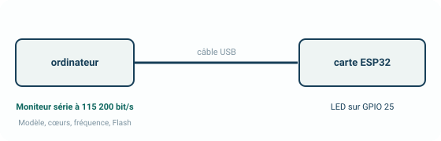

Ce mini-projet vérifie toute la chaîne : installation, compilation, téléversement et moniteur série. La carte affiche sa propre carte d'identité.

## Objectif

Téléverser un programme qui lit les caractéristiques de la puce, les affiche dans le moniteur série et fait clignoter la LED câblée sur GPIO 25 à la section 7.

## Sécurité

- La carte est alimentée par l'USB de l'ordinateur, en 5 V ; la puce travaille en 3,3 V. Aucun montage de la formation ne dépasse **12 V** en continu.
- Ne branchez jamais 5 V sur une broche GPIO.
- Posez la carte sur une surface isolante : aucune pièce métallique ne doit toucher ses broches.



## Matériel

| Quantité | Élément |
|---|---|
| 1 | carte ESP32-DevKitC V4 (ou clone 38 broches), ESP32-WROOM-32 |
| 1 | plaque d'essai et fils |
| 1 | LED rouge et résistance de 330 Ω, câblées entre G25 et GND (section 7) |
| 1 | câble USB qui transporte des données |
| 1 | ordinateur avec VS Code et PlatformIO |
| 1 | multimètre |

## Programme

```cpp
#include <Arduino.h>

// LED de GPIO 25 : elle clignote pour montrer que le programme tourne
const uint8_t LED_PIN = 25;
const uint32_t BLINK_MS = 1000;

void setup() {
  Serial.begin(115200);
  pinMode(LED_PIN, OUTPUT);
  // Laisse le temps d'ouvrir le moniteur série
  delay(2000);
  Serial.println("Carte d'identité de la puce :");
  Serial.printf("Modèle : %s, révision %d\n", ESP.getChipModel(), ESP.getChipRevision());
  Serial.printf("Cœurs : %d, fréquence : %lu MHz\n", ESP.getChipCores(), (unsigned long)ESP.getCpuFreqMHz());
  Serial.printf("Flash : %lu octets\n", (unsigned long)ESP.getFlashChipSize());
  Serial.printf("SRAM libre : %lu octets\n", (unsigned long)ESP.getFreeHeap());
}

void loop() {
  // Inverse l'état de la LED
  digitalWrite(LED_PIN, !digitalRead(LED_PIN));
  delay(BLINK_MS);
}
```

## Variante kit complet

1. Créez le projet PlatformIO avec le `platformio.ini` de référence et copiez le programme dans `src/main.cpp`.
2. Téléversez, ouvrez le moniteur série, puis appuyez sur EN : la carte d'identité s'affiche de nouveau.
3. Si vous disposez d'un oscilloscope, mesurez la tension de la broche GPIO 25 (G25) par rapport à GND : un créneau de 0 à 3,3 V, de période 2 s.

## Variante multimètre seul

1. Même programme. Relevez les lignes du moniteur série dans le tableau.
2. Avec le multimètre en voltmètre continu, mesurez entre 5V et GND, puis entre 3V3 et GND.
3. Mesurez entre G25 et GND : la valeur bascule chaque seconde entre 0 V et 3,3 V.

| Mesure | Attendue | Relevée |
|---|---|---|
| modèle de la puce | ESP32-D0WD… | |
| nombre de cœurs | 2 | |
| fréquence du processeur | 240 MHz | |
| taille de la Flash | 4 194 304 octets | |
| tension 5V / GND | environ 5 V | |
| tension 3V3 / GND | 3,3 V | |
| tension G25 / GND | 0 V puis 3,3 V | |
| tension aux bornes de la LED allumée | environ 2,0 V | |

## Pour conclure

Expliquez pourquoi la carte d'identité s'affiche de nouveau après un appui sur EN, alors que le programme n'a pas été téléversé une seconde fois.
