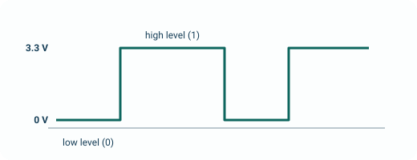
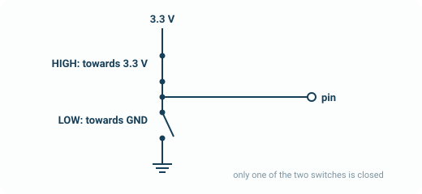

A pin set as an **output** imposes a voltage on the circuit connected to it. Like any digital output, it knows only two levels.

| Level | Arduino writing | Voltage | Logic value |
|---|---|---|---|
| high | `HIGH` | 3.3 V | 1 |
| low | `LOW` | 0 V | 0 |

## What is behind the pin

Inside the chip, each output is connected to two electronic switches (two MOSFET transistors): one towards 3.3 V, the other towards ground. The program closes one **or** the other, never both. At the high level the pin can therefore **source** current; at the low level it can **sink** current.

## How much current?

These switches are tiny. The ESP32 datasheet allows up to 40 mA per pin at the strongest setting, but the output voltage collapses long before and the chip heats up. Keep the rule of module M1: **about 12 mA at most per pin**, and a reasonable total for the whole chip. Beyond that, drive a transistor (section 6).

## An output is not a power supply

A pin gives **information** (on or off), not energy. A signalling LED draws a few milliamps: the pin can power it. A motor, a relay or a lamp need hundreds of milliamps: the pin only **drives** the switch that powers them.

## Key points

- `HIGH` = 3.3 V = 1; `LOW` = 0 V = 0.
- An output sources current at the high level and sinks it at the low level.
- About a dozen milliamps per pin at most: beyond that, a MOSFET.
