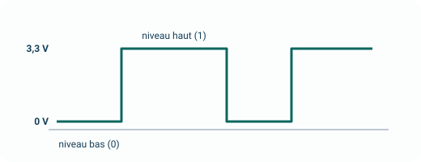
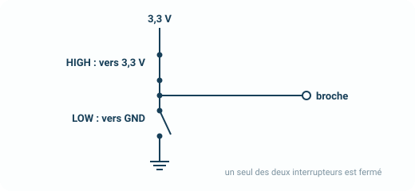

Une broche réglée en **sortie** impose une tension au circuit qui lui est relié. Comme toute sortie numérique, elle ne connaît que deux niveaux.

| Niveau | Écriture Arduino | Tension | Valeur logique |
|---|---|---|---|
| haut | `HIGH` | 3,3 V | 1 |
| bas | `LOW` | 0 V | 0 |

## Ce qu'il y a derrière la broche

Dans la puce, chaque sortie est reliée à deux interrupteurs électroniques (deux transistors MOSFET) : l'un vers le 3,3 V, l'autre vers la masse. Le programme ferme l'un **ou** l'autre, jamais les deux. Au niveau haut, la broche peut donc **fournir** du courant ; au niveau bas, elle peut en **absorber**.

## Combien de courant ?

Ces interrupteurs sont minuscules. La fiche technique de l'ESP32 autorise jusqu'à 40 mA par broche au réglage le plus fort, mais la tension de sortie s'effondre bien avant et la puce chauffe. On retient la règle du module M1 : **au plus 12 mA environ par broche**, et un total raisonnable pour toute la puce. Au-delà, on commande un transistor (section 6).

## Une sortie n'est pas une alimentation

Une broche donne une **information** (allumé ou éteint), pas de l'énergie. Une LED de signalisation consomme quelques milliampères : elle peut être alimentée par la broche. Un moteur, un relais ou une lampe demandent des centaines de milliampères : la broche ne fait que **commander** l'interrupteur qui les alimente.

## À retenir

- `HIGH` = 3,3 V = 1 ; `LOW` = 0 V = 0.
- Une sortie fournit du courant au niveau haut et en absorbe au niveau bas.
- Au plus une douzaine de milliampères par broche : au-delà, un MOSFET.
