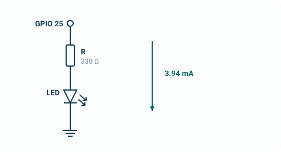
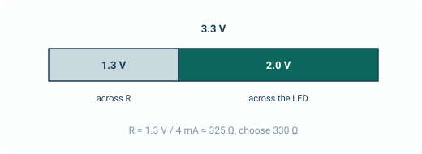

An LED connected alone between a pin and ground would let far too much current through: both the LED and the pin would be damaged. Always add a **current-limiting resistor** in series.

## The LED forward voltage

A lit LED keeps an almost constant voltage across it, its **forward voltage** Vf. It depends on the colour:

| Colour | Forward voltage Vf (about) |
|---|---|
| red | 2.0 V |
| yellow or amber | 2.1 V |
| green | 2.2 V to 3.0 V depending on the model |
| blue or white | 3.0 V to 3.2 V |

The resistor gets the rest of the pin voltage.

## Calculate the resistor

Ohm's law, applied to the resistor alone:

R = (3.3 V − Vf) / I

For a red LED and a current of 4 mA: R = (3.3 − 2.0) / 0.004 = 325 Ω. Choose the nearest standard value **above**, 330 Ω, which gives I = 1.3 / 330 ≈ 3.94 mA. A modern LED is already bright between 2 and 5 mA.

[[calc:led]]

## The case of blue and white LEDs

With Vf ≈ 3.0 V, only 0.3 V is left for the resistor: the current becomes very sensitive to the slightest variation. The LED gives little light. For a powerful white LED, supply it from 5 V or 12 V through a transistor.

## Key points

- Never an LED without a resistor.
- R = (3.3 V − Vf) / I, then the standard value above.
- 330 Ω for a red LED on 3.3 V: about 4 mA.
