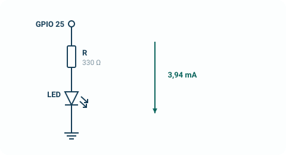
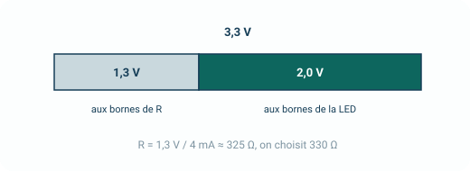

Une LED branchée seule entre une broche et la masse laisserait passer un courant beaucoup trop fort : la LED et la broche seraient abîmées. On ajoute toujours une **résistance de limitation** en série.

## La tension directe de la LED

Une LED allumée garde à ses bornes une tension presque constante, sa **tension directe** Vf. Elle dépend de la couleur :

| Couleur | Tension directe Vf (environ) |
|---|---|
| rouge | 2,0 V |
| jaune ou orange | 2,1 V |
| verte | 2,2 V à 3,0 V selon le modèle |
| bleue ou blanche | 3,0 V à 3,2 V |

La résistance reçoit le reste de la tension de la broche.

## Calculer la résistance

La loi d'Ohm, appliquée à la résistance seule :

R = (3,3 V − Vf) / I

Pour une LED rouge et un courant de 4 mA : R = (3,3 − 2,0) / 0,004 = 325 Ω. On choisit la valeur normalisée la plus proche **au-dessus**, 330 Ω, ce qui donne I = 1,3 / 330 ≈ 3,94 mA. Une LED moderne éclaire déjà bien entre 2 et 5 mA.

[[calc:led]]

## Le cas des LED bleues et blanches

Avec Vf ≈ 3,0 V, il ne reste que 0,3 V pour la résistance : le courant devient très sensible à la moindre variation. La LED éclaire peu. Pour une LED blanche puissante, on l'alimente en 5 V ou 12 V à travers un transistor.

## À retenir

- Jamais de LED sans résistance.
- R = (3,3 V − Vf) / I, puis la valeur normalisée au-dessus.
- 330 Ω pour une LED rouge sur 3,3 V : environ 4 mA.
