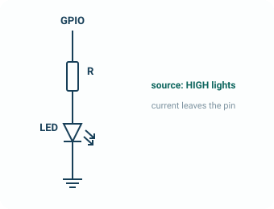
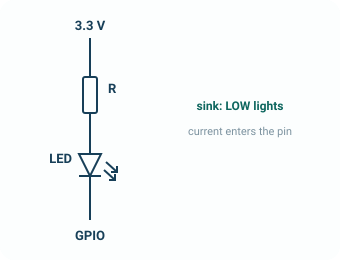

An LED can be connected to a pin in two ways. Both work; they do not light the LED with the same level.

## Direct logic: the pin is a source

The LED and its resistor go from the pin to ground. At the high level, the pin supplies the current: **`HIGH` lights**.



## Inverted logic: the pin is a sink

The LED and its resistor go from 3.3 V to the pin. At the low level, the pin sinks the current: **`LOW` lights**; at the high level, both ends are at 3.3 V and no current flows.



## Write a readable program

In inverted logic, `digitalWrite(LED_PIN, LOW)` to light surprises the reader. So name both states once and for all:

```cpp
// In inverted logic, LOW lights and HIGH switches off
const uint8_t LED_ON = LOW;
const uint8_t LED_OFF = HIGH;
```

The rest of the program writes `digitalWrite(LED_PIN, LED_ON)`: if the wiring changes, only these two lines change.

## When to choose the sink?

- Many off-the-shelf modules (relays, built-in LEDs of some boards) are wired in inverted logic: their input is active low.
- At boot, a pin briefly stays an input, imposing no voltage: an LED wired as a sink then stays off.

## Three output wirings

Source and sink are not the only circuits. The table sums up the output wirings of the course:

| Wiring | Circuit | What lights | Use |
|---|---|---|---|
| source (direct logic) | pin, resistor, LED, GND | `HIGH` | indicator LED, the most common case |
| sink (inverted logic) | 3.3 V, resistor, LED, pin | `LOW` | active-low modules, LED off at boot |
| through a transistor | pin, gate resistor, MOSFET, load on its own supply | `HIGH` | motor, relay, 12 V lamp: more than the 12 mA of a pin (section 6) |

A fourth variant exists: the **open-drain output** (`pinMode(LED_PIN, OUTPUT_OPEN_DRAIN)`). Only the switch towards ground works: `LOW` connects the pin to GND, `HIGH` leaves it floating. It is used like a sink, with an external pull-up resistor to 3.3 V; it is the principle of the I2C bus lines (module M7).

## Key points

- Source: LED to ground, `HIGH` lights.
- Sink: LED to 3.3 V, `LOW` lights.
- Beyond 12 mA, a MOSFET; in open drain, only ground is driven.
- Name `LED_ON` and `LED_OFF` so that the program reads without a diagram.
