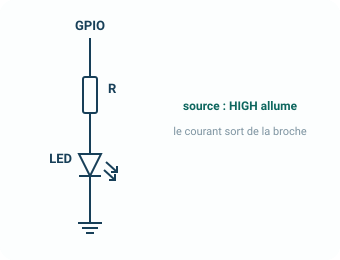
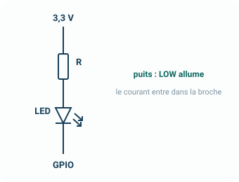

Une LED peut être reliée à une broche de deux façons. Les deux fonctionnent ; elles n'allument pas la LED avec le même niveau.

## Logique directe : la broche est une source

La LED et sa résistance vont de la broche à la masse. Au niveau haut, la broche fournit le courant : **`HIGH` allume**.



## Logique inversée : la broche est un puits

La LED et sa résistance vont du 3,3 V à la broche. Au niveau bas, la broche absorbe le courant : **`LOW` allume** ; au niveau haut, les deux bornes sont à 3,3 V et aucun courant ne passe.



## Ce qui se passe dans la broche

Derrière la broche, l'étage de sortie de la puce n'a que deux interrupteurs : P vers le 3,3 V, N vers la masse (section 1). Le bit du registre `GPIO_OUT` choisit lequel est fermé : `HIGH` ferme P, `LOW` ferme N.

- **En source**, la LED va de la broche à la masse. `HIGH` : P fermé, la broche est à 3,3 V, le courant sort de la broche, traverse la résistance et la LED vers GND : (3,3 − 2,0) / 330 ≈ 3,94 mA. `LOW` : N fermé, la broche est à 0 V comme la masse, aucun courant.
- **En puits**, la LED va du 3,3 V à la broche. `LOW` : N fermé, le courant part du 3,3 V, traverse la LED et la résistance, puis **entre** dans la broche et rejoint la masse par N : les mêmes 3,94 mA. `HIGH` : P fermé, les deux bornes de la LED sont à 3,3 V ; sans différence de tension, aucun courant ne circule et la LED reste éteinte.

La figure montre les deux câblages. Choisissez-en un, puis écrivez `HIGH` ou `LOW` : observez quel interrupteur se ferme et par où passe le courant.

[[fig:led_output]]

## Écrire un programme lisible

En logique inversée, `digitalWrite(LED_PIN, LOW)` pour allumer surprend le lecteur. On nomme donc les deux états une fois pour toutes :

```cpp
// En logique inversée, LOW allume et HIGH éteint
const uint8_t LED_ON = LOW;
const uint8_t LED_OFF = HIGH;
```

Le reste du programme écrit `digitalWrite(LED_PIN, LED_ON)` : si le câblage change, on ne modifie que ces deux lignes.

## Quand choisir le puits ?

- Beaucoup de modules du commerce (relais, LED intégrées de certaines cartes) sont câblés en logique inversée : leur entrée s'active au niveau bas.
- Au démarrage, une broche reste un court instant en entrée, sans tension imposée : une LED en puits reste alors éteinte.

## Trois câblages de sortie

Source et puits ne sont pas les seuls montages. Le tableau résume les câblages de sortie de la formation :

| Câblage | Montage | Ce qui allume | Usage |
|---|---|---|---|
| source (logique directe) | broche, résistance, LED, GND | `HIGH` | LED de signalisation, cas le plus courant |
| puits (logique inversée) | 3,3 V, résistance, LED, broche | `LOW` | modules actifs au niveau bas, LED éteinte au démarrage |
| par transistor | broche, résistance de grille, MOSFET, charge sur son alimentation | `HIGH` | moteur, relais, lampe 12 V : plus que les 12 mA d'une broche (section 6) |

Une quatrième variante existe : la **sortie à drain ouvert** (`pinMode(LED_PIN, OUTPUT_OPEN_DRAIN)`). Seul l'interrupteur vers la masse travaille : `LOW` relie la broche à GND, `HIGH` la laisse en l'air. Elle s'utilise comme un puits, avec une résistance de tirage externe vers 3,3 V ; c'est le principe des lignes du bus I2C (module M7).

## À retenir

- Source : LED vers la masse, `HIGH` allume.
- Puits : LED vers le 3,3 V, `LOW` allume.
- Au-delà de 12 mA, un MOSFET ; en drain ouvert, seule la masse est commandée.
- Nommez `LED_ON` et `LED_OFF` pour que le programme se lise sans schéma.
