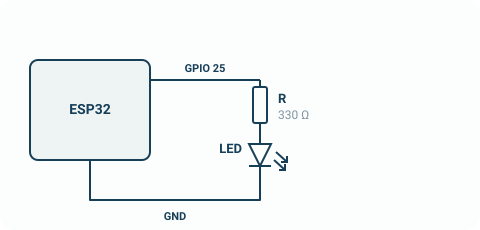

The first program of any microcontroller blinks an LED: this is **Blink**. This time the LED is external, wired in direct logic on GPIO 25.



```cpp
#include <Arduino.h>

// External LED and its 330 ohm resistor, in direct logic
const uint8_t LED_PIN = 25;
// Duration of each state, in milliseconds
const uint32_t HALF_PERIOD_MS = 500;

void setup() {
  pinMode(LED_PIN, OUTPUT);
}

void loop() {
  digitalWrite(LED_PIN, HIGH);  // 3.3 V: the LED lights up
  delay(HALF_PERIOD_MS);
  digitalWrite(LED_PIN, LOW);   // 0 V: the LED goes out
  delay(HALF_PERIOD_MS);
}
```

## The two output functions

- `pinMode(pin, OUTPUT)` makes the pin an output. Write it once, in `setup()`.
- `digitalWrite(pin, level)` imposes `HIGH` (3.3 V) or `LOW` (0 V). The pin keeps this level until the next order.

## The blinking rhythm


The LED stays on for 500 ms, then off for 500 ms: the **period** is 1000 ms, the **frequency** 1 / 1 s = 1 Hz. To blink twice as fast, divide `HALF_PERIOD_MS` by two.

## Why typed constants

- `const`: the value cannot be changed by mistake later in the program.
- `uint8_t`: an 8-bit unsigned integer (0 to 255), enough for a pin number.
- `uint32_t`: a 32-bit unsigned integer, the type of durations in milliseconds on the ESP32 (module M4).
- Upper-case names (`LED_PIN`, `HALF_PERIOD_MS`) mark a constant; the `_MS` suffix recalls the unit.

A single place to change the pin or the rhythm: this is the programmer's first good habit.

## Key points

- `pinMode(..., OUTPUT)` once, `digitalWrite(..., HIGH or LOW)` as often as needed.
- Period = on time + off time; frequency = 1 / period.
- Pins and durations as named, typed constants.
