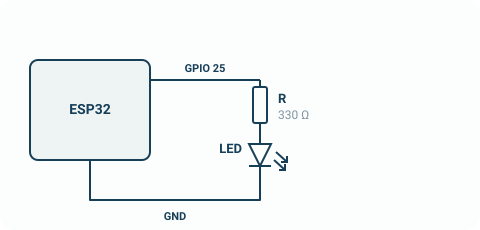
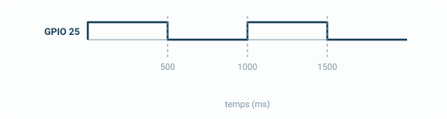

Le premier programme de tout microcontrôleur fait clignoter une LED : c'est le **Blink**. Vous l'avez téléversé au module M1, avec la LED câblée en logique directe sur GPIO 25 ; cette section reprend son montage et chacune de ses fonctions de sortie.



```cpp
#include <Arduino.h>

// LED externe et sa résistance de 330 ohms, en logique directe
const uint8_t LED_PIN = 25;
// Durée de chaque état, en millisecondes
const uint32_t HALF_PERIOD_MS = 500;

void setup() {
  pinMode(LED_PIN, OUTPUT);
}

void loop() {
  digitalWrite(LED_PIN, HIGH);  // 3,3 V : la LED s'allume
  delay(HALF_PERIOD_MS);
  digitalWrite(LED_PIN, LOW);   // 0 V : la LED s'éteint
  delay(HALF_PERIOD_MS);
}
```

## Les deux fonctions de sortie

- `pinMode(broche, OUTPUT)` fait de la broche une sortie. On l'écrit une fois, dans `setup()`.
- `digitalWrite(broche, niveau)` impose `HIGH` (3,3 V) ou `LOW` (0 V). La broche garde ce niveau jusqu'à l'ordre suivant.

## Le rythme du clignotement



La LED reste allumée 500 ms, puis éteinte 500 ms : la **période** vaut 1 000 ms, la **fréquence** 1 / 1 s = 1 Hz. Pour clignoter deux fois plus vite, on divise `HALF_PERIOD_MS` par deux.

## Pourquoi des constantes typées

- `const` : la valeur ne peut pas être modifiée par erreur plus loin dans le programme.
- `uint8_t` : un entier sans signe de 8 bits (0 à 255), assez pour un numéro de broche.
- `uint32_t` : un entier sans signe de 32 bits, le type des durées en millisecondes sur l'ESP32 (module M4).
- Les noms en majuscules (`LED_PIN`, `HALF_PERIOD_MS`) signalent une constante ; le suffixe `_MS` rappelle l'unité.

Un seul endroit à modifier pour changer de broche ou de rythme : c'est la première bonne habitude du programmeur.

## À retenir

- `pinMode(..., OUTPUT)` une fois, `digitalWrite(..., HIGH ou LOW)` autant que nécessaire.
- Période = durée allumée + durée éteinte ; fréquence = 1 / période.
- Broches et durées en constantes typées et nommées.
