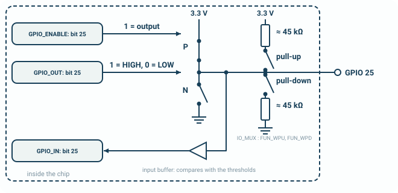
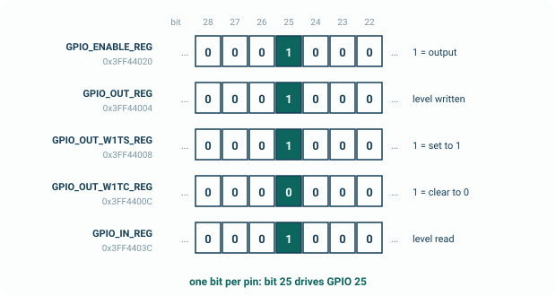

`digitalWrite` hides all the work. This section looks at what lies underneath, once and without assessment: the rest of the course uses the Arduino functions.

## What lies behind a pin

Module M1 followed a signal from the CPU to pin G25 of the board. Here is the last link, the pin's **pad**, with the registers that drive it.



- **The output stage**: two switches (MOSFET transistors), one to 3.3 V (P), the other to ground (N), never closed together (section 1).
- **GPIO_ENABLE** enables this stage: bit at 1, the pin is an output; bit at 0, both switches stay open and the pin is an input. This is what `pinMode` sets.
- **GPIO_OUT** chooses the closed switch: bit at 1, the 3.3 V one (`HIGH`); bit at 0, the ground one (`LOW`). This is what `digitalWrite` sets.
- **The internal pulls**, two resistors of about 45 kΩ behind two switches driven by the FUN_WPU and FUN_WPD bits of the IO MUX: `INPUT_PULLUP` and `INPUT_PULLDOWN` connect them (module M3).
- **The input buffer** compares the pin voltage with the thresholds and copies the result into **GPIO_IN**. This is what `digitalRead` reads.

## The principle of a register

A **register** is a 32-bit memory slot, but wired to hardware: writing to it closes switches, reading it gives the state of pins. Each register has a fixed **address**, like a slot of the SRAM. For the pins, each register has **one bit per pin**: bit 25 is about GPIO 25.



| Register | Address | Role | Arduino function |
|---|---|---|---|
| `GPIO_ENABLE_REG` | 0x3FF44020 | 1 = output, 0 = input | `pinMode` |
| `GPIO_OUT_REG` | 0x3FF44004 | level imposed on the outputs | `digitalWrite` |
| `GPIO_OUT_W1TS_REG` | 0x3FF44008 | writing 1 sets the GPIO_OUT bit to 1 | `digitalWrite(…, HIGH)` |
| `GPIO_OUT_W1TC_REG` | 0x3FF4400C | writing 1 clears the GPIO_OUT bit to 0 | `digitalWrite(…, LOW)` |
| `GPIO_IN_REG` | 0x3FF4403C | level read on each pin | `digitalRead` |

Why W1TS and W1TC? Writing directly to GPIO_OUT would change all 32 bits at once, hence every output. With W1TS (*write 1 to set*), only the bits written as 1 become 1; bits at 0 change nothing. A single write changes one pin without touching the others.

## Three levels for the same action

The program below switches the same LED on and off in three ways. All three give exactly the same result on the pin.


**1. Arduino.** The most readable function, the same on every Arduino board:

```cpp
  // 1. Arduino: the simplest function
  digitalWrite(LED_PIN, HIGH);
```

**2. ESP-IDF.** The development framework of Espressif, the manufacturer. Arduino is built on it. It expects a pin number of type `gpio_num_t`:

```cpp
  // 2. ESP-IDF: Espressif's driver
  gpio_set_level((gpio_num_t)LED_PIN, 1);
```

**3. Registers.** At the lowest level, you write to the register yourself:

```cpp
  // 3. Registers: one bit per pin
  REG_WRITE(GPIO_OUT_W1TS_REG, 1UL << LED_PIN);  // sets bit 25 to 1
```

`1UL << LED_PIN` shifts a 1 by 25 places to the left: it is a number in which only bit 25 is 1 (0x02000000). Written to `GPIO_OUT_W1TS_REG`, it sets GPIO 25 high without touching the other pins; written to `GPIO_OUT_W1TC_REG`, it sets it back low. To read, you would do the reverse: `(REG_READ(GPIO_IN_REG) >> 4) & 1` isolates bit 4, the level of GPIO 4.

## Which one to choose?

| Level | Advantage | Drawback |
|---|---|---|
| Arduino | readable, portable from one board to another | a few more microseconds |
| ESP-IDF | access to every option of the chip | specific to Espressif |
| Registers | the fastest | unreadable, specific to this chip, error-prone |

To light an LED or run a motor, the speed difference cannot be seen: **write in Arduino**. Registers are for when every microsecond counts.

## Key points

- A pin is an output stage, two internal pulls and an input buffer, driven by registers.
- A register has one bit per pin: ENABLE (direction), OUT (level written), IN (level read).
- `pinMode`, `digitalWrite` and `digitalRead` write and read these registers for you; in the course, we program in Arduino.
