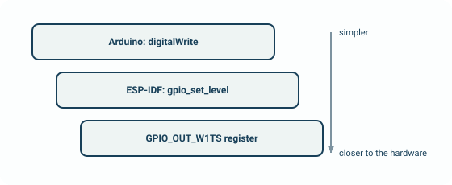
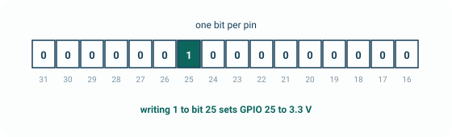

`digitalWrite` hides all the work. This section looks at what lies underneath, once and without assessment: the rest of the course uses the Arduino functions.



## Three levels for the same action

The program below switches the same LED on and off in three ways. All three give exactly the same result on the pin.

**1. Arduino.** The most readable function, the same on every Arduino board:

```cpp
  // 1. Arduino: the simplest function
  digitalWrite(LED_PIN, HIGH);
```

**2. ESP-IDF.** The development framework of Espressif, the manufacturer. Arduino is built on it. It expects a pin number of type `gpio_num_t`:

```cpp
  // 2. ESP-IDF: Espressif's driver
  gpio_set_level((gpio_num_t)LED_PIN, 1);
```

**3. Registers.** At the lowest level, the pin is driven by a **register**, a 32-bit word of the chip in which each bit corresponds to a pin.

```cpp
  // 3. Registers: one bit per pin
  REG_WRITE(GPIO_OUT_W1TS_REG, 1UL << LED_PIN);  // sets bit 25 to 1
```



`1UL << LED_PIN` is a number in which only bit 25 is 1. Writing it to `GPIO_OUT_W1TS_REG` (*write 1 to set*) sets GPIO 25 high without touching the other pins; the `GPIO_OUT_W1TC_REG` register (*write 1 to clear*) sets it back low.

## Which one to choose?

| Level | Advantage | Drawback |
|---|---|---|
| Arduino | readable, portable from one board to another | a few more microseconds |
| ESP-IDF | access to every option of the chip | specific to Espressif |
| Registers | the fastest | unreadable, specific to this chip, error-prone |

To light an LED or run a motor, the speed difference cannot be seen: **write in Arduino**. Registers are for when every microsecond counts.

## Key points

- `digitalWrite` calls the ESP-IDF driver, which writes to a register.
- An output register has one bit per pin.
- In the course, we program in Arduino.
