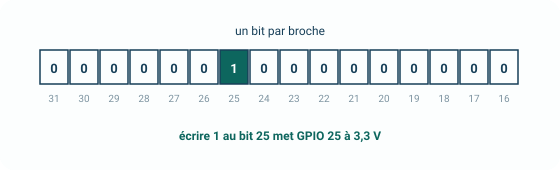

`digitalWrite` cache tout le travail. Cette section regarde ce qu'il y a dessous, une seule fois et sans examen : la suite de la formation utilise les fonctions Arduino.


## Trois niveaux pour un même geste

Le programme ci-dessous allume et éteint la même LED de trois façons. Les trois donnent exactement le même résultat sur la broche.

**1. Arduino.** La fonction la plus lisible, la même sur toutes les cartes Arduino :

```cpp
  // 1. Arduino : la fonction la plus simple
  digitalWrite(LED_PIN, HIGH);
```

**2. ESP-IDF.** Le cadre de développement d'Espressif, le fabricant. Arduino s'appuie dessus. Il attend un numéro de broche de type `gpio_num_t` :

```cpp
  // 2. ESP-IDF : le pilote d'Espressif
  gpio_set_level((gpio_num_t)LED_PIN, 1);
```

**3. Registres.** Au plus bas niveau, la broche est commandée par un **registre**, un mot de 32 bits de la puce dont chaque bit correspond à une broche.

```cpp
  // 3. Registres : un bit par broche
  REG_WRITE(GPIO_OUT_W1TS_REG, 1UL << LED_PIN);  // met le bit 25 à 1
```



`1UL << LED_PIN` vaut un nombre dont seul le bit 25 est à 1. Écrire ce nombre dans `GPIO_OUT_W1TS_REG` (*write 1 to set*) met GPIO 25 au niveau haut sans toucher aux autres broches ; le registre `GPIO_OUT_W1TC_REG` (*write 1 to clear*) la remet au niveau bas.

## Lequel choisir ?

| Niveau | Avantage | Inconvénient |
|---|---|---|
| Arduino | lisible, portable d'une carte à l'autre | quelques microsecondes de plus |
| ESP-IDF | accès à toutes les options de la puce | propre à Espressif |
| Registres | le plus rapide | illisible, propre à cette puce, risque d'erreur |

Pour allumer une LED ou un moteur, la différence de vitesse ne se voit pas : **on écrit en Arduino**. Les registres servent quand chaque microseconde compte.

## À retenir

- `digitalWrite` appelle le pilote ESP-IDF, qui écrit dans un registre.
- Un registre de sortie compte un bit par broche.
- Dans la formation, on programme en Arduino.
