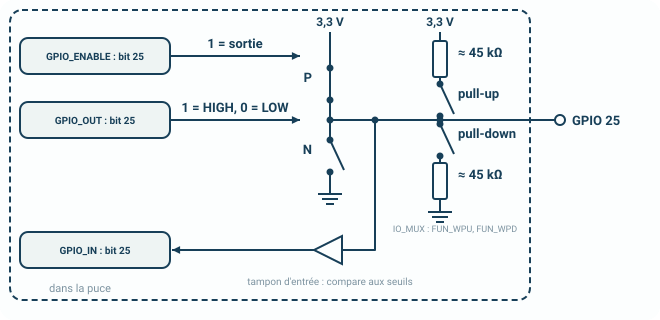
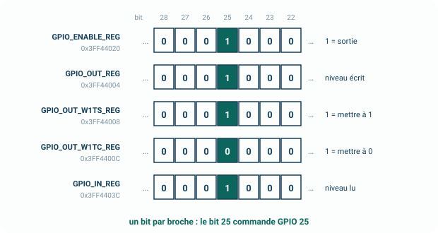
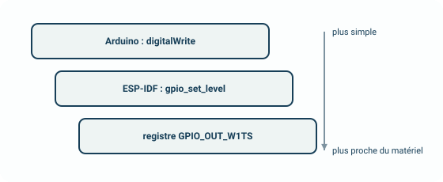

`digitalWrite` cache tout le travail. Cette section regarde ce qu'il y a dessous, une seule fois et sans examen : la suite de la formation utilise les fonctions Arduino.

## Ce qu'il y a derrière une broche

Le module M1 a suivi le chemin d'un signal, du CPU jusqu'à la broche G25 de la carte. Voici le dernier maillon, le **plot** de la broche, avec les registres qui le commandent.



- **L'étage de sortie** : deux interrupteurs (des transistors MOSFET), l'un vers 3,3 V (P), l'autre vers la masse (N), jamais fermés ensemble (section 1).
- **GPIO_ENABLE** autorise cet étage : bit à 1, la broche est une sortie ; bit à 0, les deux interrupteurs restent ouverts et la broche est une entrée. C'est ce que règle `pinMode`.
- **GPIO_OUT** choisit l'interrupteur fermé : bit à 1, celui du 3,3 V (`HIGH`) ; bit à 0, celui de la masse (`LOW`). C'est ce que règle `digitalWrite`.
- **Les tirages internes**, deux résistances d'environ 45 kΩ derrière deux interrupteurs commandés par les bits FUN_WPU et FUN_WPD de l'IO MUX : `INPUT_PULLUP` et `INPUT_PULLDOWN` les branchent (module M3).
- **Le tampon d'entrée** compare la tension de la broche aux seuils et recopie le résultat dans **GPIO_IN**. C'est ce que lit `digitalRead`.

## Le principe d'un registre

Un **registre** est une case mémoire de 32 bits, mais branchée sur du matériel : écrire dedans ferme des interrupteurs, le lire donne l'état de broches. Chaque registre a une **adresse** fixe, comme une case de la SRAM. Pour les broches, chaque registre compte **un bit par broche** : le bit 25 concerne GPIO 25.



| Registre | Adresse | Rôle | Fonction Arduino |
|---|---|---|---|
| `GPIO_ENABLE_REG` | 0x3FF44020 | 1 = sortie, 0 = entrée | `pinMode` |
| `GPIO_OUT_REG` | 0x3FF44004 | niveau imposé aux sorties | `digitalWrite` |
| `GPIO_OUT_W1TS_REG` | 0x3FF44008 | écrire 1 met le bit de GPIO_OUT à 1 | `digitalWrite(…, HIGH)` |
| `GPIO_OUT_W1TC_REG` | 0x3FF4400C | écrire 1 met le bit de GPIO_OUT à 0 | `digitalWrite(…, LOW)` |
| `GPIO_IN_REG` | 0x3FF4403C | niveau lu sur chaque broche | `digitalRead` |

Pourquoi W1TS et W1TC ? Écrire directement dans GPIO_OUT changerait les 32 bits d'un coup, donc toutes les sorties. Avec W1TS (*write 1 to set*), seuls les bits écrits à 1 passent à 1 ; les bits à 0 ne changent rien. Une seule écriture modifie une broche sans toucher aux autres.

## Trois niveaux pour un même geste

Le programme ci-dessous allume et éteint la même LED de trois façons. Les trois donnent exactement le même résultat sur la broche.



**1. Arduino.** La fonction la plus lisible, la même sur toutes les cartes Arduino :

```cpp
  // 1. Arduino : la fonction la plus simple
  digitalWrite(LED_PIN, HIGH);
```

**2. ESP-IDF.** Le cadre de développement d'Espressif, le fabricant. Arduino s'appuie dessus. Il attend un numéro de broche de type `gpio_num_t` :

```cpp
  // 2. ESP-IDF : le pilote d'Espressif
  gpio_set_level((gpio_num_t)LED_PIN, 1);
```

**3. Registres.** Au plus bas niveau, on écrit soi-même dans le registre :

```cpp
  // 3. Registres : un bit par broche
  REG_WRITE(GPIO_OUT_W1TS_REG, 1UL << LED_PIN);  // met le bit 25 à 1
```

`1UL << LED_PIN` décale un 1 de 25 rangs vers la gauche : c'est un nombre dont seul le bit 25 vaut 1 (0x02000000). Écrit dans `GPIO_OUT_W1TS_REG`, il met GPIO 25 au niveau haut sans toucher aux autres broches ; écrit dans `GPIO_OUT_W1TC_REG`, il la remet au niveau bas. Pour lire, on ferait l'inverse : `(REG_READ(GPIO_IN_REG) >> 4) & 1` isole le bit 4, le niveau de GPIO 4.

## Lequel choisir ?

| Niveau | Avantage | Inconvénient |
|---|---|---|
| Arduino | lisible, portable d'une carte à l'autre | quelques microsecondes de plus |
| ESP-IDF | accès à toutes les options de la puce | propre à Espressif |
| Registres | le plus rapide | illisible, propre à cette puce, risque d'erreur |

Pour allumer une LED ou un moteur, la différence de vitesse ne se voit pas : **on écrit en Arduino**. Les registres servent quand chaque microseconde compte.

## À retenir

- Une broche, c'est un étage de sortie, deux tirages internes et un tampon d'entrée, commandés par des registres.
- Un registre compte un bit par broche : ENABLE (direction), OUT (niveau écrit), IN (niveau lu).
- `pinMode`, `digitalWrite` et `digitalRead` écrivent et lisent ces registres pour vous ; dans la formation, on programme en Arduino.
