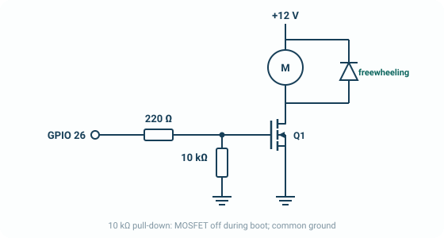
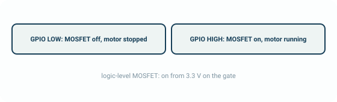

A pin supplies only about a dozen milliamps at 3.3 V. To drive a motor, a lamp or an LED strip at **12 V**, it is only given the gate of a **MOSFET transistor**, which switches the power.



## The components of the circuit

- **N-channel logic-level MOSFET** (for example IRLZ44N): it becomes fully on with 3.3 V on its gate. An ordinary MOSFET needs 10 V and would heat up half open.
- **Gate resistor, 220 Ω**, between the pin and the gate: it limits the current peak at each switching.
- **Pull-down resistor, 10 kΩ**, between the gate and ground: during boot, the pin imposes nothing yet; the resistor keeps the gate at 0 V and the motor stopped.
- **Freewheeling diode** (for example 1N4007) in parallel with the motor, cathode towards +12 V: at each switch-off, the motor, which is a coil, produces a surge; the diode drains it.
- **Common ground**: the ESP32 GND and the minus of the 12 V supply are joined (rule 3 of module M1).

## The MOSFET as a switch



The transistor works as a switch, like the ones you have studied: off, it lets no current through; on, it keeps almost no voltage. In both states, it hardly heats up.

## The program

```cpp
#include <Arduino.h>

// MOSFET gate (through 220 ohms), 10 kohm pull-down to GND
const uint8_t MOSFET_PIN = 26;
const uint32_t ON_MS = 2000;
const uint32_t OFF_MS = 2000;

void setup() {
  pinMode(MOSFET_PIN, OUTPUT);
  digitalWrite(MOSFET_PIN, LOW);  // motor stopped at start-up
}

void loop() {
  digitalWrite(MOSFET_PIN, HIGH);  // MOSFET on: the 12 V motor runs
  delay(ON_MS);
  digitalWrite(MOSFET_PIN, LOW);   // MOSFET off: the motor stops
  delay(OFF_MS);
}
```

For the program nothing changes: the pin is written as for an LED. All the difference lies in the wiring.

## Key points

- The pin drives the gate; the logic-level MOSFET switches the 12 V.
- 220 Ω on the gate, 10 kΩ from gate to ground.
- Freewheeling diode on every load that contains a coil (motor, relay).
- Common ground between the ESP32 and the 12 V supply.
