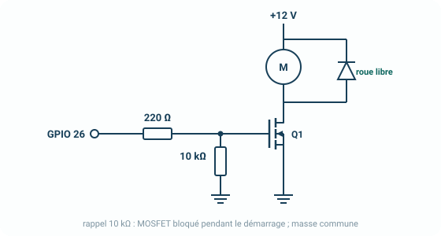
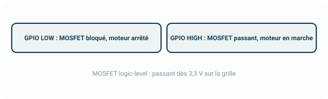

Une broche ne fournit qu'une douzaine de milliampères en 3,3 V. Pour commander un moteur, une lampe ou un ruban de LED en **12 V**, on lui confie seulement la grille d'un **transistor MOSFET**, qui commute la puissance.



## Les composants du montage

- **MOSFET à canal N, de type logic-level** (par exemple IRLZ44N) : il devient pleinement passant avec 3,3 V sur sa grille. Un MOSFET ordinaire demande 10 V et chaufferait à moitié ouvert.
- **Résistance de grille, 220 Ω**, entre la broche et la grille : elle limite le pic de courant à chaque commutation.
- **Résistance de rappel, 10 kΩ**, entre la grille et la masse : pendant le démarrage, la broche n'impose encore rien ; la résistance garde la grille à 0 V et le moteur arrêté.
- **Diode de roue libre** (par exemple 1N4007) en parallèle sur le moteur, cathode vers le +12 V : à chaque coupure, le moteur, qui est une bobine, produit une surtension ; la diode l'écoule.
- **Masse commune** : le GND de l'ESP32 et le moins de l'alimentation 12 V sont reliés (règle 3 du module M1).

## Le MOSFET en commutation



Le transistor travaille en interrupteur, comme ceux que vous avez étudiés : bloqué, il ne laisse passer aucun courant ; passant, il ne garde presque aucune tension. Dans les deux états, il chauffe très peu.

## Le programme

```cpp
#include <Arduino.h>

// Grille du MOSFET (à travers 220 ohms), rappel de 10 kohms vers GND
const uint8_t MOSFET_PIN = 26;
const uint32_t ON_MS = 2000;
const uint32_t OFF_MS = 2000;

void setup() {
  pinMode(MOSFET_PIN, OUTPUT);
  digitalWrite(MOSFET_PIN, LOW);  // moteur arrêté au démarrage
}

void loop() {
  digitalWrite(MOSFET_PIN, HIGH);  // MOSFET passant : le moteur 12 V tourne
  delay(ON_MS);
  digitalWrite(MOSFET_PIN, LOW);   // MOSFET bloqué : le moteur s'arrête
  delay(OFF_MS);
}
```

Pour le programme, rien ne change : la broche s'écrit comme pour une LED. Toute la différence est dans le câblage.

## À retenir

- La broche commande la grille ; le MOSFET logic-level commute le 12 V.
- 220 Ω sur la grille, 10 kΩ de la grille vers la masse.
- Diode de roue libre sur toute charge qui contient une bobine (moteur, relais).
- Masse commune entre l'ESP32 et l'alimentation 12 V.
