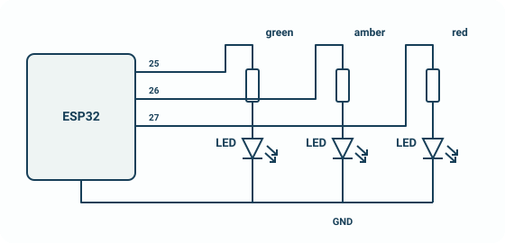
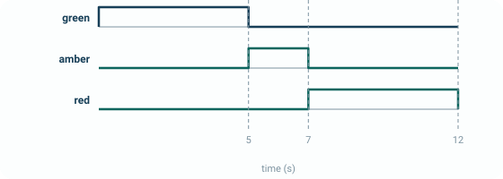

Several outputs driven in a precise order form a **sequence**. The classic example is the traffic light.



## The cycle

A traffic light in France goes from green to amber, from amber to red, then back to green. The durations chosen here are short for bench testing:



## The program

```cpp
#include <Arduino.h>

// Three LEDs, each with its 330 ohm resistor
const uint8_t GREEN_PIN = 25;
const uint8_t AMBER_PIN = 26;
const uint8_t RED_PIN = 27;
// Cycle durations, in milliseconds
const uint32_t GREEN_MS = 5000;
const uint32_t AMBER_MS = 2000;
const uint32_t RED_MS = 5000;

// Lights a single LED of the traffic light and switches the other two off
void showLight(uint8_t pin) {
  digitalWrite(GREEN_PIN, pin == GREEN_PIN ? HIGH : LOW);
  digitalWrite(AMBER_PIN, pin == AMBER_PIN ? HIGH : LOW);
  digitalWrite(RED_PIN, pin == RED_PIN ? HIGH : LOW);
}

void setup() {
  pinMode(GREEN_PIN, OUTPUT);
  pinMode(AMBER_PIN, OUTPUT);
  pinMode(RED_PIN, OUTPUT);
}

void loop() {
  showLight(GREEN_PIN);
  delay(GREEN_MS);
  showLight(AMBER_PIN);
  delay(AMBER_MS);
  showLight(RED_PIN);
  delay(RED_MS);
}
```

## A function so as not to repeat yourself

The `showLight` function receives the pin to light and sets **all three** LEDs at each call. So two colours can never stay on together by oversight.

The expression `pin == GREEN_PIN ? HIGH : LOW` reads: "if `pin` equals `GREEN_PIN`, then `HIGH`, otherwise `LOW`".

## The length of a cycle

The cycle lasts 5 + 2 + 5 = 12 s. During each `delay`, the program does nothing else: it cannot, for example, watch a pedestrian button. Module M4 replaces these waits with a clock that does not block.

## Key points

- A sequence = outputs driven in a chosen order and with chosen durations.
- A function that sets all outputs at once avoids inconsistent states.
- `delay` blocks the program: enough here, a problem as soon as an input must also be read.
