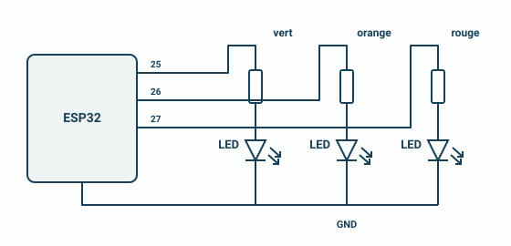
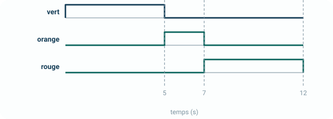

Plusieurs sorties commandées dans un ordre précis forment une **séquence**. L'exemple classique est le feu tricolore.



## Le cycle

Un feu de circulation en France passe du vert à l'orange, de l'orange au rouge, puis revient au vert. Les durées choisies ici sont courtes pour l'essai sur table :



## Le programme

```cpp
#include <Arduino.h>

// Trois LED, chacune avec sa résistance de 330 ohms
const uint8_t GREEN_PIN = 25;
const uint8_t AMBER_PIN = 26;
const uint8_t RED_PIN = 27;
// Durées du cycle, en millisecondes
const uint32_t GREEN_MS = 5000;
const uint32_t AMBER_MS = 2000;
const uint32_t RED_MS = 5000;

// Allume une seule LED du feu et éteint les deux autres
void showLight(uint8_t pin) {
  digitalWrite(GREEN_PIN, pin == GREEN_PIN ? HIGH : LOW);
  digitalWrite(AMBER_PIN, pin == AMBER_PIN ? HIGH : LOW);
  digitalWrite(RED_PIN, pin == RED_PIN ? HIGH : LOW);
}

void setup() {
  pinMode(GREEN_PIN, OUTPUT);
  pinMode(AMBER_PIN, OUTPUT);
  pinMode(RED_PIN, OUTPUT);
}

void loop() {
  showLight(GREEN_PIN);
  delay(GREEN_MS);
  showLight(AMBER_PIN);
  delay(AMBER_MS);
  showLight(RED_PIN);
  delay(RED_MS);
}
```

## Une fonction pour ne pas se répéter

La fonction `showLight` reçoit la broche à allumer et règle **les trois** LED à chaque appel. Ainsi, deux couleurs ne peuvent jamais rester allumées ensemble par oubli.

L'expression `pin == GREEN_PIN ? HIGH : LOW` se lit : « si `pin` vaut `GREEN_PIN`, alors `HIGH`, sinon `LOW` ».

## La durée d'un cycle

Le cycle dure 5 + 2 + 5 = 12 s. Pendant chaque `delay`, le programme ne fait rien d'autre : impossible, par exemple, de surveiller un bouton de passage piéton. Le module M4 remplace ces attentes par une horloge qui ne bloque pas.

## À retenir

- Une séquence = des sorties commandées dans un ordre et avec des durées choisies.
- Une fonction qui règle toutes les sorties d'un coup évite les états incohérents.
- `delay` bloque le programme : suffisant ici, gênant dès qu'il faut aussi lire une entrée.
