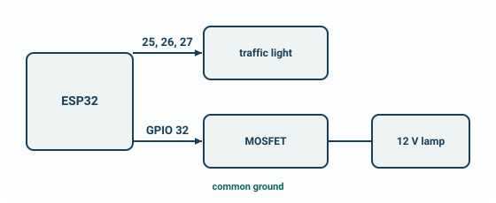

This mini-project brings the LEDs and the MOSFET together: a traffic light also drives a 12 V lamp, lit during red.

## Goal

Wire the traffic light and the MOSFET drive of a 12 V lamp, upload the program and check voltages, current and durations.

## Safety

- The power circuit never goes above **12 V** DC, supplied by a **wall adapter** from 230 V to 12 V. Never open the adapter and never work on the 230 V side.
- Never 5 V nor 12 V on an ESP32 pin: the 12 V only reaches the lamp and the drain of the MOSFET.
- Join the ESP32 GND to the minus of the 12 V supply (common ground).
- Always wire with the power off: USB cable and adapter unplugged.



## Equipment

| Quantity | Item |
|---|---|
| 1 | ESP32 DevKit board, breadboard and wires |
| 3 | green, amber (or yellow) and red LEDs |
| 3 | 330 Ω resistors |
| 1 | N-channel logic-level MOSFET (for example IRLZ44N) |
| 1 | one 220 Ω and one 10 kΩ resistor |
| 1 | 1N4007 diode (essential if the lamp is replaced by the motor) |
| 1 | 12 V lamp or LED strip, 230 V to 12 V wall adapter |
| 1 | multimeter |

## Program

```cpp
#include <Arduino.h>

// Traffic light: three LEDs with their 330 ohm resistors
const uint8_t GREEN_PIN = 25;
const uint8_t AMBER_PIN = 26;
const uint8_t RED_PIN = 27;
// Gate of the MOSFET that drives the 12 V lamp (220 ohms, 10 kohm pull-down)
const uint8_t LAMP_PIN = 32;
const uint32_t GREEN_MS = 5000;
const uint32_t AMBER_MS = 2000;
const uint32_t RED_MS = 5000;

// Lights a single LED; the 12 V lamp lights up with red
void showLight(uint8_t pin) {
  digitalWrite(GREEN_PIN, pin == GREEN_PIN ? HIGH : LOW);
  digitalWrite(AMBER_PIN, pin == AMBER_PIN ? HIGH : LOW);
  digitalWrite(RED_PIN, pin == RED_PIN ? HIGH : LOW);
  digitalWrite(LAMP_PIN, pin == RED_PIN ? HIGH : LOW);
}

void setup() {
  Serial.begin(115200);
  pinMode(GREEN_PIN, OUTPUT);
  pinMode(AMBER_PIN, OUTPUT);
  pinMode(RED_PIN, OUTPUT);
  pinMode(LAMP_PIN, OUTPUT);
  digitalWrite(LAMP_PIN, LOW);
}

void loop() {
  Serial.println("green");
  showLight(GREEN_PIN);
  delay(GREEN_MS);
  Serial.println("amber");
  showLight(AMBER_PIN);
  delay(AMBER_MS);
  Serial.println("red: 12 V lamp on");
  showLight(RED_PIN);
  delay(RED_MS);
}
```

## Full kit variant

1. Wire the traffic light, then the MOSFET with its two resistors, the lamp and the common ground. Have the wiring checked before plugging in the adapter.
2. Upload and open the serial monitor: each colour announces itself.
3. On the oscilloscope, channel 1 on GPIO 25 and channel 2 on GPIO 32: measure the green and red durations, and check that the gate never rises during green.

## Multimeter-only variant

1. Same circuit and same program.
2. Measure the voltage across each lit LED, then across its resistor; deduce the current I = U / 330.
3. During red, measure the voltage between drain and source of the MOSFET, then across the lamp.
4. Time the complete cycle.

| Measurement | Expected | Measured |
|---|---|---|
| voltage across the red LED | about 2.0 V | |
| voltage across its resistor | about 1.3 V | |
| red LED current | about 3.9 mA | |
| drain-source voltage during red | a few tenths of a volt | |
| voltage across the lamp during red | almost 12 V | |
| cycle duration | 12 s | |

## To conclude

Explain why the lamp stays off while the board boots, even before `setup()` sets pin 32.
