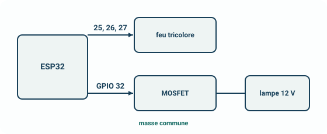

Ce mini-projet réunit les LED et le MOSFET : un feu tricolore commande aussi une lampe de 12 V, allumée pendant le rouge.

## Objectif

Câbler le feu tricolore et la commande d'une lampe 12 V par MOSFET, téléverser le programme et vérifier tensions, courant et durées.

## Sécurité

- Le circuit de puissance ne dépasse jamais **12 V** en continu, fourni par un **adaptateur mural** 230 V vers 12 V. On n'ouvre jamais l'adaptateur et on ne travaille jamais côté 230 V.
- Jamais 5 V ni 12 V sur une broche de l'ESP32 : le 12 V ne touche que la lampe et le drain du MOSFET.
- Reliez le GND de l'ESP32 au moins de l'alimentation 12 V (masse commune).
- Câblez toujours hors tension : câble USB et adaptateur débranchés.



## Matériel

| Quantité | Élément |
|---|---|
| 1 | carte DevKit ESP32, plaque d'essai et fils |
| 3 | LED verte, orange (ou jaune) et rouge |
| 3 | résistances de 330 Ω |
| 1 | MOSFET canal N logic-level (par exemple IRLZ44N) |
| 1 | résistance de 220 Ω et une de 10 kΩ |
| 1 | diode 1N4007 (indispensable si la lampe est remplacée par le moteur) |
| 1 | lampe ou ruban de LED 12 V, adaptateur mural 230 V vers 12 V |
| 1 | multimètre |

## Programme

```cpp
#include <Arduino.h>

// Feu tricolore : trois LED avec leur résistance de 330 ohms
const uint8_t GREEN_PIN = 25;
const uint8_t AMBER_PIN = 26;
const uint8_t RED_PIN = 27;
// Grille du MOSFET qui commande la lampe 12 V (220 ohms, rappel 10 kohms)
const uint8_t LAMP_PIN = 32;
const uint32_t GREEN_MS = 5000;
const uint32_t AMBER_MS = 2000;
const uint32_t RED_MS = 5000;

// Allume une seule LED ; la lampe 12 V s'allume avec le rouge
void showLight(uint8_t pin) {
  digitalWrite(GREEN_PIN, pin == GREEN_PIN ? HIGH : LOW);
  digitalWrite(AMBER_PIN, pin == AMBER_PIN ? HIGH : LOW);
  digitalWrite(RED_PIN, pin == RED_PIN ? HIGH : LOW);
  digitalWrite(LAMP_PIN, pin == RED_PIN ? HIGH : LOW);
}

void setup() {
  Serial.begin(115200);
  pinMode(GREEN_PIN, OUTPUT);
  pinMode(AMBER_PIN, OUTPUT);
  pinMode(RED_PIN, OUTPUT);
  pinMode(LAMP_PIN, OUTPUT);
  digitalWrite(LAMP_PIN, LOW);
}

void loop() {
  Serial.println("vert");
  showLight(GREEN_PIN);
  delay(GREEN_MS);
  Serial.println("orange");
  showLight(AMBER_PIN);
  delay(AMBER_MS);
  Serial.println("rouge : lampe 12 V allumée");
  showLight(RED_PIN);
  delay(RED_MS);
}
```

## Variante kit complet

1. Câblez le feu, puis le MOSFET avec ses deux résistances, la lampe et la masse commune. Faites vérifier le câblage avant de brancher l'adaptateur.
2. Téléversez et ouvrez le moniteur série : chaque couleur s'annonce.
3. À l'oscilloscope, voie 1 sur GPIO 25 et voie 2 sur GPIO 32 : relevez les durées du vert et du rouge, et vérifiez que la grille ne monte jamais pendant le vert.

## Variante multimètre seul

1. Même montage et même programme.
2. Mesurez la tension aux bornes de chaque LED allumée, puis aux bornes de sa résistance ; déduisez le courant I = U / 330.
3. Pendant le rouge, mesurez la tension entre drain et source du MOSFET, puis aux bornes de la lampe.
4. Chronométrez le cycle complet.

| Mesure | Attendue | Relevée |
|---|---|---|
| tension aux bornes de la LED rouge | environ 2,0 V | |
| tension aux bornes de sa résistance | environ 1,3 V | |
| courant de la LED rouge | environ 3,9 mA | |
| tension drain-source pendant le rouge | quelques dixièmes de volt | |
| tension aux bornes de la lampe pendant le rouge | presque 12 V | |
| durée du cycle | 12 s | |

## Pour conclure

Expliquez pourquoi la lampe reste éteinte pendant le démarrage de la carte, avant même que `setup()` ne règle la broche 32.
