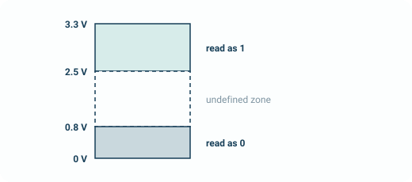
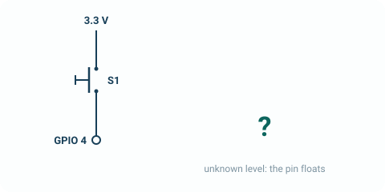

A pin set as an **input** imposes nothing: it **measures** the voltage presented to it and turns it into a 0 or a 1. Reading a button looks simple; yet a trap awaits every beginner.

## How the input decides

The input compares the voltage with two thresholds. For the ESP32 supplied at 3.3 V:

- above about **2.5 V** (75 % of 3.3 V), it reads **1** (`HIGH`);
- below about **0.8 V** (25 % of 3.3 V), it reads **0** (`LOW`);
- in between, the result is not guaranteed: a well-designed circuit never stays there.

## The floating-input trap

Wire a button between 3.3 V and an input, and nothing else. Button pressed, the input gets 3.3 V: it reads 1. Button released, the input is connected to **nothing**: it is said to **float**.

A floating input has a huge resistance: the slightest electric charge, a nearby wire, an approaching hand is enough to make it switch. The program then reads 0s and 1s at random. The button is not faulty: the circuit lacks one part, the **pull resistor** (next section).

## Key points

- An input reads 1 above about 2.5 V, 0 below about 0.8 V.
- An input connected to nothing floats and reads anything.
- Every input must have a defined level, button pressed **and** released.
