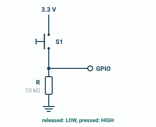
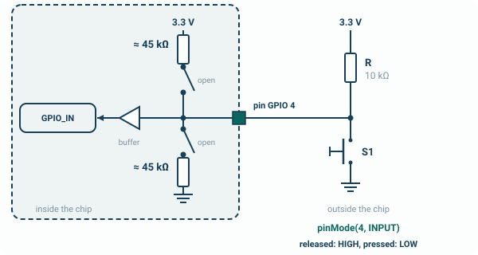
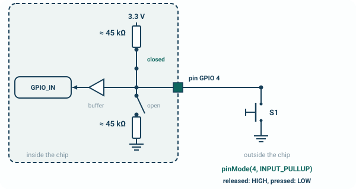
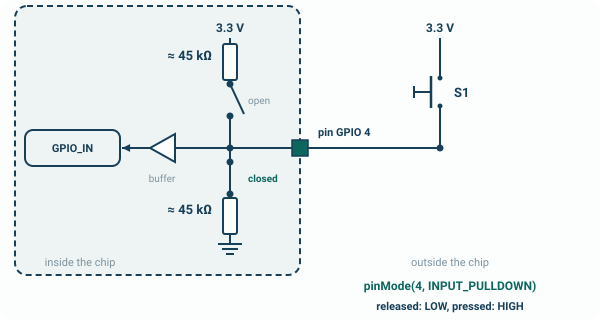

A **pull resistor** gives the input a default level when the button is released. It is high enough to let only a small current through when the button is pressed.

It can be **external** (a part you wire) or **internal** (a resistor already inside the chip, which the program connects). Each diagram below shows both sides of the pin: **inside the chip**, the input buffer that copies the level into the `GPIO_IN` register and the two internal pull resistors of about 45 kΩ, each behind a switch; **outside the chip**, what you wire to pin GPIO 4.

## 1. External pull-down to ground

- **Inside the chip**: `pinMode(4, INPUT)` leaves both internal switches **open**. Only the input buffer is connected to the pin; it only measures.
- **Outside the chip**: a 10 kΩ resistor goes from the pin to **GND**; the button goes from **3.3 V** to the pin.
- **Button released**: no current flows through the resistor, it pulls the pin to 0 V: the input reads `LOW`.
- **Button pressed**: the button imposes 3.3 V, the input reads `HIGH`. A current of 3.3 V / 10 kΩ = 0.33 mA flows through the resistor to ground.

## 2. External pull-up to 3.3 V

- **Inside the chip**: still `pinMode(4, INPUT)`, internal switches **open**.
- **Outside the chip**: the 10 kΩ resistor goes from **3.3 V** to the pin; the button goes from the pin to **GND**.
- **Button released**: the resistor pulls the pin to 3.3 V: the input reads `HIGH`.
- **Button pressed**: the button ties the pin to ground, it reads `LOW`; 0.33 mA flow through the resistor then the button.

Watch the logic: with a pull-up, **pressed gives `LOW`**.

## 3. Internal pull-up to 3.3 V (INPUT_PULLUP)

- **Inside the chip**: `pinMode(4, INPUT_PULLUP)` **closes** the upper switch. The internal resistor of about 45 kΩ now ties the pin to 3.3 V, exactly like the external resistor of circuit 2.
- **Outside the chip**: a single part, the button, between the pin and **GND**. No wire to 3.3 V.
- **Button released**: `HIGH`. **Pressed**: `LOW`, with about 3.3 V / 45 kΩ ≈ 0.07 mA.

This is the most common circuit: one part less, and no wire to 3.3 V.

## 4. Internal pull-down to ground (INPUT_PULLDOWN)

- **Inside the chip**: `pinMode(4, INPUT_PULLDOWN)` **closes** the lower switch: the internal resistor ties the pin to ground, like the external resistor of circuit 1.
- **Outside the chip**: only the button, between **3.3 V** and the pin.
- **Button released**: `LOW`. **Pressed**: `HIGH`.

## Seeing the four circuits

The figure brings the four circuits together on one bench. On the left, the chip is open: you see the two internal pulls and their switches, the input buffer and the flag of the `GPIO_IN` register, raised when the level read is 1. On the right, outside the chip, what you wire. Choose a circuit, then press S1: released, the pull imposes its level with no current flowing; pressed, the button imposes the other level and a small current flows through the pull resistor, and through it alone.

[[fig:pull_wiring]]

## Comparing the four circuits

| Circuit | Inside the chip | Outside the chip | Released | Pressed |
|---|---|---|---|---|
| 1. external pull-down | `INPUT`, pulls open | 10 kΩ to GND, button to 3.3 V | `LOW` | `HIGH` |
| 2. external pull-up | `INPUT`, pulls open | 10 kΩ to 3.3 V, button to GND | `HIGH` | `LOW` |
| 3. internal pull-up | `INPUT_PULLUP`, upper pull closed | button to GND | `HIGH` | `LOW` |
| 4. internal pull-down | `INPUT_PULLDOWN`, lower pull closed | button to 3.3 V | `LOW` | `HIGH` |

Never combine an internal pull and an external pull in opposite directions: the two resistors would form a voltage divider and the input would stay between the two thresholds.

## When to choose an external resistor?

- **GPIO 34 to 39** have no internal pull (module M1): a button on these pins requires circuit 1 or 2.
- With a long wire or a noisy environment, a lower external resistor (4.7 kΩ or 10 kΩ) holds the level better than the internal 45 kΩ.
- Why 10 kΩ? Low enough to impose the level despite interference, high enough to draw only 0.33 mA with the button pressed. 1 kΩ would waste 3.3 mA; 1 MΩ would leave the input almost floating.

## Key points

- Pull-down: released `LOW`, pressed `HIGH`. Pull-up: released `HIGH`, pressed `LOW`.
- External: a wired resistor, `INPUT`. Internal: `INPUT_PULLUP` or `INPUT_PULLDOWN` closes a switch inside the chip, about 45 kΩ.
- GPIO 34 to 39: no internal pull, external resistor required.
