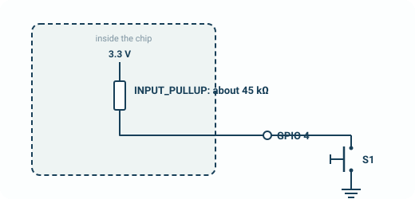

A **pull resistor** gives the input a default level when the button is released. It is high enough to let only a small current through when the button is pressed.

## Pull-down to ground

The resistor connects the input to ground; the button goes from 3.3 V to the input.

- released: the resistor pulls the input to 0 V, it reads `LOW`;
- pressed: the button imposes 3.3 V, it reads `HIGH`. A current of 3.3 V / 10 kΩ = 0.33 mA flows through the resistor.

## Pull-up to 3.3 V

The resistor connects the input to 3.3 V; the button goes from the input to ground.

- released: the input is pulled to 3.3 V, it reads `HIGH`;
- pressed: the button connects it to ground, it reads `LOW`.

Mind the logic: with a pull-up, **pressed gives `LOW`**.

## The internal resistors

Behind most of its pins, the ESP32 holds pull resistors of about **45 kΩ** that are enabled by the program. No external resistor is needed any more:

| Writing | Effect |
|---|---|
| `pinMode(BUTTON_PIN, INPUT)` | input without pull: an external resistor is needed |
| `pinMode(BUTTON_PIN, INPUT_PULLUP)` | internal pull-up to 3.3 V: pressed = `LOW` |
| `pinMode(BUTTON_PIN, INPUT_PULLDOWN)` | internal pull-down to ground: pressed = `HIGH` |

The most common circuit is the **button between the pin and GND, with `INPUT_PULLUP`**: a single component, no wire to 3.3 V. Reminder from module M1: GPIO 34 to 39 have no internal pull; a button on these pins needs an external resistor.

## Key points

- Pull-down: released `LOW`, pressed `HIGH`. Pull-up: released `HIGH`, pressed `LOW`.
- `INPUT_PULLUP` enables an internal pull-up of about 45 kΩ.
- GPIO 34 to 39: no internal pull.
