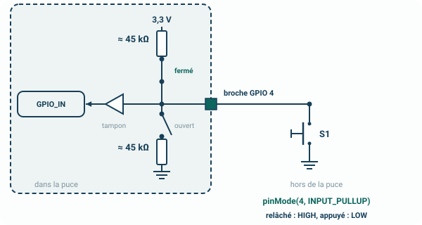
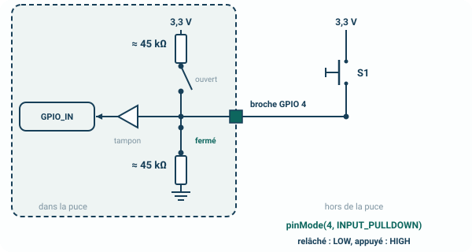

Une **résistance de tirage** donne à l'entrée un niveau par défaut quand le bouton est relâché. Elle est assez forte pour ne laisser passer qu'un petit courant quand le bouton est appuyé.

Elle peut être **externe** (un composant que vous câblez) ou **interne** (une résistance déjà présente dans la puce, que le programme branche). Chaque schéma ci-dessous montre les deux côtés de la broche : **dans la puce**, le tampon d'entrée qui recopie le niveau dans le registre `GPIO_IN` et les deux tirages internes d'environ 45 kΩ, chacun derrière un interrupteur ; **hors de la puce**, ce que vous câblez sur la broche GPIO 4.

## 1. Tirage externe vers la masse (pull-down)

- **Dans la puce** : `pinMode(4, INPUT)` laisse les deux interrupteurs internes **ouverts**. Seul le tampon d'entrée est relié à la broche ; il ne fait que mesurer.
- **Hors de la puce** : une résistance de 10 kΩ va de la broche à **GND** ; le bouton va du **3,3 V** à la broche.
- **Bouton relâché** : aucun courant ne traverse la résistance, elle tire la broche à 0 V : l'entrée lit `LOW`.
- **Bouton appuyé** : le bouton impose 3,3 V, l'entrée lit `HIGH`. Un courant de 3,3 V / 10 kΩ = 0,33 mA traverse la résistance vers la masse.

## 2. Tirage externe vers 3,3 V (pull-up)

- **Dans la puce** : toujours `pinMode(4, INPUT)`, interrupteurs internes **ouverts**.
- **Hors de la puce** : la résistance de 10 kΩ va du **3,3 V** à la broche ; le bouton va de la broche à **GND**.
- **Bouton relâché** : la résistance tire la broche à 3,3 V : l'entrée lit `HIGH`.
- **Bouton appuyé** : le bouton relie la broche à la masse, elle lit `LOW` ; 0,33 mA traversent la résistance puis le bouton.

Attention à la logique : avec un pull-up, **appuyé donne `LOW`**.

## 3. Tirage interne vers 3,3 V (INPUT_PULLUP)

- **Dans la puce** : `pinMode(4, INPUT_PULLUP)` **ferme** l'interrupteur du haut. La résistance interne d'environ 45 kΩ relie maintenant la broche au 3,3 V, exactement comme la résistance externe du montage 2.
- **Hors de la puce** : un seul composant, le bouton, entre la broche et **GND**. Aucun fil vers le 3,3 V.
- **Bouton relâché** : `HIGH`. **Appuyé** : `LOW`, avec environ 3,3 V / 45 kΩ ≈ 0,07 mA.

C'est le montage le plus courant : un composant de moins, et aucun fil vers le 3,3 V.

## 4. Tirage interne vers la masse (INPUT_PULLDOWN)

- **Dans la puce** : `pinMode(4, INPUT_PULLDOWN)` **ferme** l'interrupteur du bas : la résistance interne relie la broche à la masse, comme la résistance externe du montage 1.
- **Hors de la puce** : seul le bouton, entre le **3,3 V** et la broche.
- **Bouton relâché** : `LOW`. **Appuyé** : `HIGH`.

## Voir les quatre câblages

La figure réunit les quatre montages sur un même banc. À gauche, la puce est ouverte : on y voit les deux tirages internes et leurs interrupteurs, le tampon d'entrée et le drapeau du registre `GPIO_IN`, levé quand le niveau lu vaut 1. À droite, hors de la puce, ce que vous câblez. Choisissez un câblage, puis appuyez sur S1 : relâché, le tirage impose son niveau sans qu'aucun courant circule ; appuyé, le bouton impose l'autre niveau et un petit courant traverse la résistance de tirage, et elle seule.

[[fig:pull_wiring]]

## Comparer les quatre montages

| Montage | Dans la puce | Hors de la puce | Relâché | Appuyé |
|---|---|---|---|---|
| 1. pull-down externe | `INPUT`, tirages ouverts | 10 kΩ vers GND, bouton vers 3,3 V | `LOW` | `HIGH` |
| 2. pull-up externe | `INPUT`, tirages ouverts | 10 kΩ vers 3,3 V, bouton vers GND | `HIGH` | `LOW` |
| 3. pull-up interne | `INPUT_PULLUP`, tirage haut fermé | bouton vers GND | `HIGH` | `LOW` |
| 4. pull-down interne | `INPUT_PULLDOWN`, tirage bas fermé | bouton vers 3,3 V | `LOW` | `HIGH` |

Ne combinez jamais un tirage interne et un tirage externe de sens opposés : les deux résistances formeraient un pont diviseur et l'entrée resterait entre les deux seuils.

## Quand choisir une résistance externe ?

- **GPIO 34 à 39** n'ont pas de tirage interne (module M1) : un bouton sur ces broches exige le montage 1 ou 2.
- Avec un fil long ou un environnement bruité, une résistance externe plus faible (4,7 kΩ ou 10 kΩ) tient mieux le niveau que les 45 kΩ internes.
- Pourquoi 10 kΩ ? Assez faible pour imposer le niveau malgré les parasites, assez forte pour ne consommer que 0,33 mA bouton appuyé. 1 kΩ gaspillerait 3,3 mA ; 1 MΩ laisserait l'entrée presque flotter.

## À retenir

- Pull-down : relâché `LOW`, appuyé `HIGH`. Pull-up : relâché `HIGH`, appuyé `LOW`.
- Externe : une résistance câblée, `INPUT`. Interne : `INPUT_PULLUP` ou `INPUT_PULLDOWN` ferme un interrupteur dans la puce, environ 45 kΩ.
- GPIO 34 à 39 : pas de tirage interne, résistance externe obligatoire.
