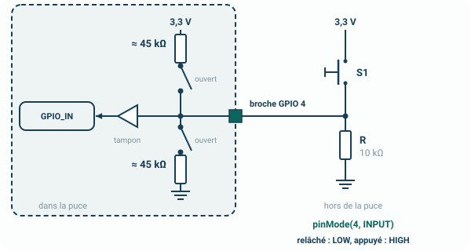
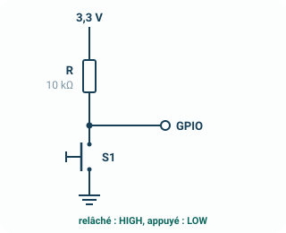
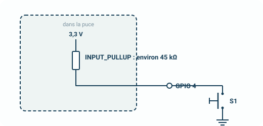

Une **résistance de tirage** donne à l'entrée un niveau par défaut quand le bouton est relâché. Elle est assez forte pour ne laisser passer qu'un petit courant quand le bouton est appuyé.

## Tirage vers la masse (pull-down)

La résistance relie l'entrée à la masse ; le bouton va du 3,3 V à l'entrée.

- relâché : la résistance tire l'entrée à 0 V, elle lit `LOW` ;
- appuyé : le bouton impose 3,3 V, elle lit `HIGH`. Un courant de 3,3 V / 10 kΩ = 0,33 mA traverse la résistance.

## Tirage vers 3,3 V (pull-up)

La résistance relie l'entrée au 3,3 V ; le bouton va de l'entrée à la masse.

- relâché : l'entrée est tirée à 3,3 V, elle lit `HIGH` ;
- appuyé : le bouton la relie à la masse, elle lit `LOW`.

Attention à la logique : avec un pull-up, **appuyé donne `LOW`**.

## Les résistances internes

L'ESP32 contient, derrière la plupart de ses broches, des résistances de tirage d'environ **45 kΩ** qu'on active par programme. Plus besoin de résistance externe :

| Écriture | Effet |
|---|---|
| `pinMode(BUTTON_PIN, INPUT)` | entrée sans tirage : il faut une résistance externe |
| `pinMode(BUTTON_PIN, INPUT_PULLUP)` | tirage interne vers 3,3 V : appuyé = `LOW` |
| `pinMode(BUTTON_PIN, INPUT_PULLDOWN)` | tirage interne vers la masse : appuyé = `HIGH` |

Le montage le plus courant est le **bouton entre la broche et GND, avec `INPUT_PULLUP`** : un seul composant, aucun fil vers le 3,3 V. Rappel du module M1 : GPIO 34 à 39 n'ont pas de tirage interne ; un bouton sur ces broches demande une résistance externe.

## À retenir

- Pull-down : relâché `LOW`, appuyé `HIGH`. Pull-up : relâché `HIGH`, appuyé `LOW`.
- `INPUT_PULLUP` active un tirage interne d'environ 45 kΩ.
- GPIO 34 à 39 : pas de tirage interne.
