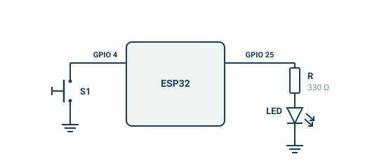
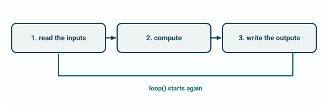

`digitalRead(pin)` returns the level read, `HIGH` or `LOW`. First program: the LED lights as long as the button is pressed.



```cpp
#include <Arduino.h>

// Button between GPIO 4 and GND, internal pull-up to 3.3 V
const uint8_t BUTTON_PIN = 4;
// LED and its 330 ohm resistor
const uint8_t LED_PIN = 25;

void setup() {
  pinMode(BUTTON_PIN, INPUT_PULLUP);
  pinMode(LED_PIN, OUTPUT);
}

void loop() {
  // 1. Read the input: with the internal pull-up, pressed gives LOW
  bool pressed = (digitalRead(BUTTON_PIN) == LOW);
  // 2. Write the output
  digitalWrite(LED_PIN, pressed ? HIGH : LOW);
}
```

## Read, then write



The loop is arranged in steps: **first read all the inputs** into variables, **compute**, then **write all the outputs**. This discipline seems unnecessary here; yet it avoids subtle errors as soon as the program grows, because each decision relies on a single snapshot of the inputs.

## A variable with a telling name

`bool pressed` holds `true` or `false`. The test `digitalRead(BUTTON_PIN) == LOW` translates the inverted logic of the pull-up once and for all: the rest of the program talks about a **pressed** button, not about a `LOW` level.

## Key points

- `digitalRead` returns `HIGH` or `LOW`.
- With `INPUT_PULLUP`, pressed = `LOW`: translate it into a `pressed` variable.
- In `loop()`, read first, write afterwards.
