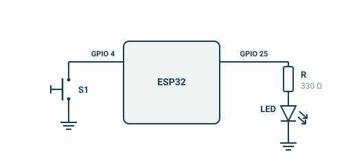
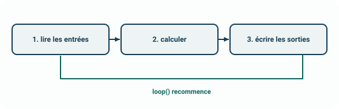

`digitalRead(broche)` renvoie le niveau lu, `HIGH` ou `LOW`. Premier programme : la LED s'allume tant que le bouton est appuyé.



```cpp
#include <Arduino.h>

// Bouton entre GPIO 4 et GND, tirage interne vers 3,3 V
const uint8_t BUTTON_PIN = 4;
// LED et sa résistance de 330 ohms
const uint8_t LED_PIN = 25;

void setup() {
  pinMode(BUTTON_PIN, INPUT_PULLUP);
  pinMode(LED_PIN, OUTPUT);
}

void loop() {
  // 1. Lire l'entrée : avec le tirage interne, appuyé donne LOW
  bool pressed = (digitalRead(BUTTON_PIN) == LOW);
  // 2. Écrire la sortie
  digitalWrite(LED_PIN, pressed ? HIGH : LOW);
}
```

## Lire, puis écrire



La boucle est rangée en étapes : on **lit d'abord toutes les entrées** dans des variables, on **calcule**, puis on **écrit toutes les sorties**. Cette discipline paraît superflue ici ; elle évite pourtant des erreurs sournoises dès que le programme grandit, car chaque décision s'appuie sur une photographie unique des entrées.

## Une variable au nom parlant

`bool pressed` contient `true` ou `false`. Le test `digitalRead(BUTTON_PIN) == LOW` traduit la logique inversée du pull-up une fois pour toutes : la suite du programme parle de bouton **appuyé**, pas de niveau `LOW`.

## À retenir

- `digitalRead` renvoie `HIGH` ou `LOW`.
- Avec `INPUT_PULLUP`, appuyé = `LOW` : traduisez-le dans une variable `pressed`.
- Dans `loop()`, lisez d'abord, écrivez ensuite.
