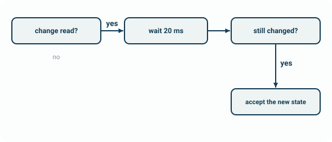

A button is mechanical: when pressed, its metal blades bump into each other and the contact opens and closes several times before settling. These are the **bounces**.


They usually last less than **10 ms**, sometimes 20 ms for a worn button. The eye sees nothing. But `loop()` runs hundreds of thousands of times per second: during the bounces, the program reads several presses where there was only one. For an LED following the button, this is invisible; for a press counter, it is wrong.

## Software debouncing

The idea: when a change appears, **wait for the bounces to end**, then read again. The change is accepted only if it is still there.



```cpp
void loop() {
  int level = digitalRead(BUTTON_PIN);
  if (level != stableLevel) {
    // A change: wait for the bounces to end, then read again
    delay(DEBOUNCE_MS);
    if (digitalRead(BUTTON_PIN) == level) {
      stableLevel = level;
      Serial.println(stableLevel == LOW ? "pressed" : "released");
    }
  }
  digitalWrite(LED_PIN, stableLevel == LOW ? HIGH : LOW);
}
```

`stableLevel` keeps the last **accepted** level. With `DEBOUNCE_MS = 20`, the serial monitor shows exactly one "pressed" and one "released" per press.

## Hardware debouncing

Bounces can also be filtered by a capacitor (about 100 nF) between the input and ground, which smooths pulses that are too short. In this course, debouncing is done in software: no extra component.

## Key points

- One press produces several edges within a few milliseconds.
- Debouncing: wait about 20 ms, read again, accept only if the level holds.
- A variable keeps the last accepted state.
