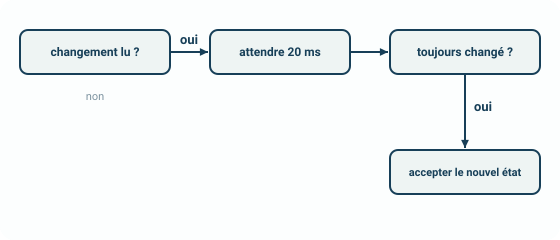

Un bouton est mécanique : à l'appui, ses lamelles métalliques s'entrechoquent et le contact s'ouvre et se ferme plusieurs fois avant de se stabiliser. Ce sont les **rebonds**.


Ils durent en général moins de **10 ms**, parfois 20 ms pour un bouton usé. L'œil ne voit rien. Mais `loop()` tourne des centaines de milliers de fois par seconde : pendant les rebonds, le programme lit plusieurs appuis là où il n'y en a eu qu'un. Pour une LED qui suit le bouton, c'est invisible ; pour un compteur d'appuis, c'est faux.

## L'anti-rebond logiciel

L'idée : quand un changement apparaît, on **attend que les rebonds soient finis**, puis on relit. Le changement n'est accepté que s'il est toujours là.



```cpp
void loop() {
  int level = digitalRead(BUTTON_PIN);
  if (level != stableLevel) {
    // Un changement : on attend la fin des rebonds, puis on relit
    delay(DEBOUNCE_MS);
    if (digitalRead(BUTTON_PIN) == level) {
      stableLevel = level;
      Serial.println(stableLevel == LOW ? "appuyé" : "relâché");
    }
  }
  digitalWrite(LED_PIN, stableLevel == LOW ? HIGH : LOW);
}
```

`stableLevel` garde le dernier niveau **accepté**. Avec `DEBOUNCE_MS = 20`, le moniteur série affiche exactement un « appuyé » et un « relâché » par appui.

## L'anti-rebond matériel

On peut aussi filtrer les rebonds par un condensateur (environ 100 nF) entre l'entrée et la masse, qui lisse les impulsions trop courtes. Dans cette formation, l'anti-rebond est logiciel : pas de composant en plus.

## À retenir

- Un appui produit plusieurs fronts en quelques millisecondes.
- Anti-rebond : attendre 20 ms environ, relire, accepter seulement si le niveau tient.
- Une variable garde le dernier état accepté.
