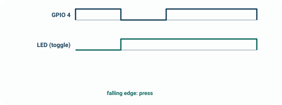
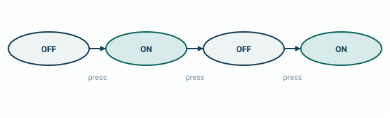

Reading a level tells whether the button **is** pressed. Often you want to know whether it **has just been** pressed: this is an **edge**, a change of level.



- **falling edge**: change from `HIGH` to `LOW`. With `INPUT_PULLUP`, this is the **press**;
- **rising edge**: change from `LOW` to `HIGH`, the release.

To recognise an edge, you must remember the level read during the previous pass through `loop()`, in a `previousLevel` variable. A falling edge is `previousLevel == HIGH` and the current level `LOW`.

## The toggle

Example: the first press lights the LED, the second switches it off, and so on, whatever the length of the press.



```cpp
#include <Arduino.h>

const uint8_t BUTTON_PIN = 4;
const uint8_t LED_PIN = 25;
const uint32_t DEBOUNCE_MS = 20;

// Level read during the previous pass through loop()
int previousLevel = HIGH;
// LED state: 0 off, 1 on
uint8_t ledState = 0;

void setup() {
  pinMode(BUTTON_PIN, INPUT_PULLUP);
  pinMode(LED_PIN, OUTPUT);
}

void loop() {
  // 1. Read the input
  int level = digitalRead(BUTTON_PIN);
  // 2. Compute: a falling edge (HIGH then LOW) is a new press
  if (previousLevel == HIGH && level == LOW) {
    ledState ^= 1;  // exclusive OR: 0 becomes 1, 1 becomes 0
    delay(DEBOUNCE_MS);
  }
  previousLevel = level;
  // 3. Write the output
  digitalWrite(LED_PIN, ledState);
}
```

## The ^= operator

`^` is the bitwise **exclusive OR** (XOR): `0 ^ 1 = 1` and `1 ^ 1 = 0`. Writing `ledState ^= 1` therefore inverts `ledState` at each call, in a single instruction. You will also see `ledState = !ledState`, which does the same with a boolean variable.

## Key points

- Falling edge = `HIGH` then `LOW`; with `INPUT_PULLUP`, this is the press.
- A `previousLevel` variable keeps the level of the previous pass.
- `^= 1` inverts a 0 or 1 state.
