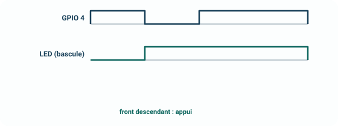
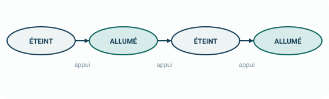

Lire un niveau dit si le bouton **est** appuyé. Souvent, on veut savoir s'il **vient d'être** appuyé : c'est un **front**, un changement de niveau.



- **front descendant** : passage de `HIGH` à `LOW`. Avec `INPUT_PULLUP`, c'est l'**appui** ;
- **front montant** : passage de `LOW` à `HIGH`, le relâchement.

Pour reconnaître un front, il faut se souvenir du niveau lu au tour précédent de `loop()`, dans une variable `previousLevel`. Un front descendant, c'est `previousLevel == HIGH` et le niveau actuel `LOW`.

## La bascule

Exemple : le premier appui allume la LED, le deuxième l'éteint, et ainsi de suite, quelle que soit la durée de l'appui.



```cpp
#include <Arduino.h>

const uint8_t BUTTON_PIN = 4;
const uint8_t LED_PIN = 25;
const uint32_t DEBOUNCE_MS = 20;

// Niveau lu au passage précédent dans loop()
int previousLevel = HIGH;
// État de la LED : 0 éteinte, 1 allumée
uint8_t ledState = 0;

void setup() {
  pinMode(BUTTON_PIN, INPUT_PULLUP);
  pinMode(LED_PIN, OUTPUT);
}

void loop() {
  // 1. Lire l'entrée
  int level = digitalRead(BUTTON_PIN);
  // 2. Calculer : un front descendant (HIGH puis LOW) est un nouvel appui
  if (previousLevel == HIGH && level == LOW) {
    ledState ^= 1;  // OU exclusif : 0 devient 1, 1 devient 0
    delay(DEBOUNCE_MS);
  }
  previousLevel = level;
  // 3. Écrire la sortie
  digitalWrite(LED_PIN, ledState);
}
```

## L'opérateur ^=

`^` est le **OU exclusif** (XOR) bit à bit : `0 ^ 1 = 1` et `1 ^ 1 = 0`. Écrire `ledState ^= 1` inverse donc `ledState` à chaque appel, en une seule instruction. On rencontre aussi `ledState = !ledState`, qui fait la même chose avec une variable booléenne.

## À retenir

- Front descendant = `HIGH` puis `LOW` ; avec `INPUT_PULLUP`, c'est l'appui.
- Une variable `previousLevel` garde le niveau du tour précédent.
- `^= 1` inverse un état 0 ou 1.
