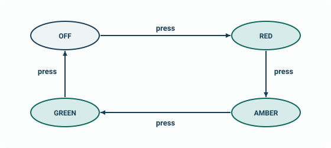
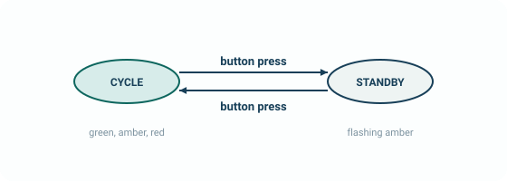

When a program must remember where it stands, it is described as a **state machine**: a finite list of states, and events that move from one to another.

## A cycle driven by a button

The three traffic-light LEDs are off at the start. Each press moves on to the next state: red, then amber, then green, then everything goes off and the cycle starts again.



```cpp
// The four states of the machine
enum State { STATE_OFF, STATE_RED, STATE_AMBER, STATE_GREEN };

State state = STATE_OFF;
int previousLevel = HIGH;
```

`enum` creates a type whose values have names: the program writes `STATE_RED` rather than a mysterious number. The `state` variable stores the current state.

```cpp
  if (previousLevel == HIGH && level == LOW) {
    // 2. Compute: each press moves on to the next state
    switch (state) {
      case STATE_OFF:   state = STATE_RED;   break;
      case STATE_RED:   state = STATE_AMBER; break;
      case STATE_AMBER: state = STATE_GREEN; break;
      case STATE_GREEN: state = STATE_OFF;   break;
    }
    delay(DEBOUNCE_MS);
  }
```

`switch` picks the line that matches the current state; `break` leaves the `switch`. The outputs are then written **from the state**, and from the state only:

```cpp
  // 3. Write the outputs from the state
  digitalWrite(RED_PIN, state == STATE_RED ? HIGH : LOW);
  digitalWrite(AMBER_PIN, state == STATE_AMBER ? HIGH : LOW);
  digitalWrite(GREEN_PIN, state == STATE_GREEN ? HIGH : LOW);
```

## Operating modes

The same principle describes **modes**. A real traffic light has a normal cycle and a standby mode, flashing amber: a press switches from one to the other. This is the mini-project of this module.



## Key points

- State machine: named states (`enum`), a state variable, transitions triggered by events.
- `switch` picks the transition from the current state.
- The outputs follow from the state: never two traffic-light LEDs on by mistake.
