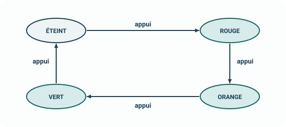
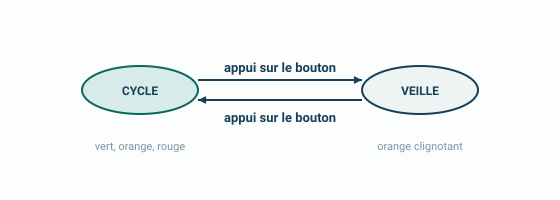

Quand un programme doit se souvenir d'où il en est, on le décrit comme une **machine à états** : une liste finie d'états, et des événements qui font passer de l'un à l'autre.

## Un cycle commandé par un bouton

Les trois LED du feu sont éteintes au départ. Chaque appui fait passer à l'état suivant : rouge, puis orange, puis vert, puis tout s'éteint et le cycle recommence.



```cpp
// Les quatre états de la machine
enum State { STATE_OFF, STATE_RED, STATE_AMBER, STATE_GREEN };

State state = STATE_OFF;
int previousLevel = HIGH;
```

`enum` crée un type dont les valeurs sont nommées : le programme écrit `STATE_RED` plutôt qu'un nombre mystérieux. La variable `state` mémorise l'état courant.

```cpp
  if (previousLevel == HIGH && level == LOW) {
    // 2. Calculer : chaque appui fait passer à l'état suivant
    switch (state) {
      case STATE_OFF:   state = STATE_RED;   break;
      case STATE_RED:   state = STATE_AMBER; break;
      case STATE_AMBER: state = STATE_GREEN; break;
      case STATE_GREEN: state = STATE_OFF;   break;
    }
    delay(DEBOUNCE_MS);
  }
```

`switch` choisit la ligne qui correspond à l'état courant ; `break` sort du `switch`. Les sorties sont ensuite écrites **d'après l'état**, et seulement d'après lui :

```cpp
  // 3. Écrire les sorties d'après l'état
  digitalWrite(RED_PIN, state == STATE_RED ? HIGH : LOW);
  digitalWrite(AMBER_PIN, state == STATE_AMBER ? HIGH : LOW);
  digitalWrite(GREEN_PIN, state == STATE_GREEN ? HIGH : LOW);
```

## Des modes de fonctionnement

Le même principe décrit des **modes**. Un feu réel a un cycle normal et un mode veille, orange clignotant : un appui passe de l'un à l'autre. C'est le mini-projet de ce module.



## À retenir

- Machine à états : des états nommés (`enum`), une variable d'état, des transitions déclenchées par des événements.
- `switch` choisit la transition d'après l'état courant.
- Les sorties se déduisent de l'état : jamais deux LED du feu allumées par erreur.
