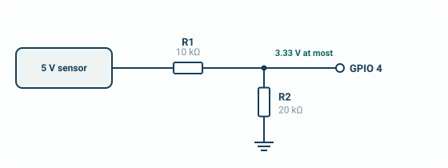
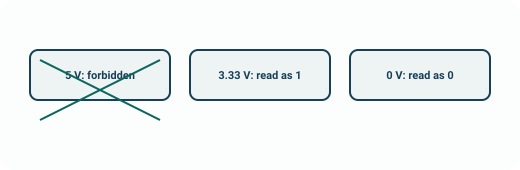

Many sensors and modules output a logic signal at **5 V**: motion detector, Hall-effect sensor, output of another board. Reminder of rule 1 of module M1: **5 V destroys an ESP32 pin**.

## The voltage divider on an input

Two resistors bring the 5 V high level down to an acceptable voltage.

Vout = Vin × R2 / (R1 + R2) = 5 V × 20 kΩ / 30 kΩ ≈ 3.33 V.

[[calc:divider]]

- Sensor high level, 5 V: the input gets 3.33 V, well above the 2.5 V threshold: it reads `HIGH`.
- Sensor low level, 0 V: the input gets 0 V, it reads `LOW`.

## Choosing the resistors

- The **ratio** R2 / (R1 + R2) sets the voltage: 2 / 3 suits 5 V. Module M1 used 1 kΩ and 2 kΩ, the same ratio.
- The **value** sets the current drawn: 5 V / 30 kΩ ≈ 0.17 mA. Resistors of several tens of kilohms spare the sensor; above 100 kΩ the signal becomes sensitive to interference.
- With a divider, do **not** enable an internal pull on the input: `pinMode(SENSOR_PIN, INPUT)`. The divider already sets the level.

## Key points

- A 5 V signal goes through a voltage divider before any input.
- 10 kΩ and 20 kΩ give 3.33 V: the input reads `HIGH`.
- Input set as `INPUT`, without internal pull, behind a divider.
